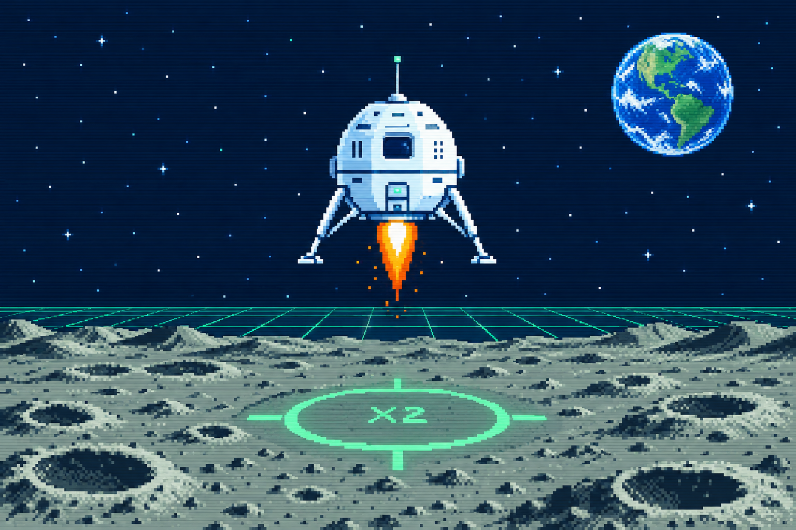
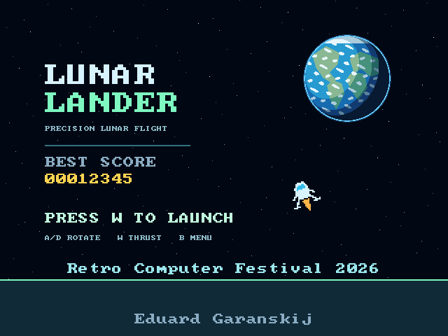
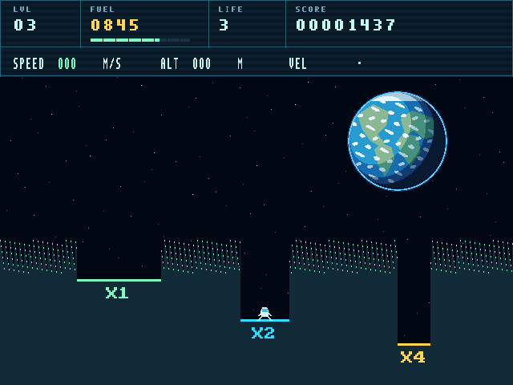
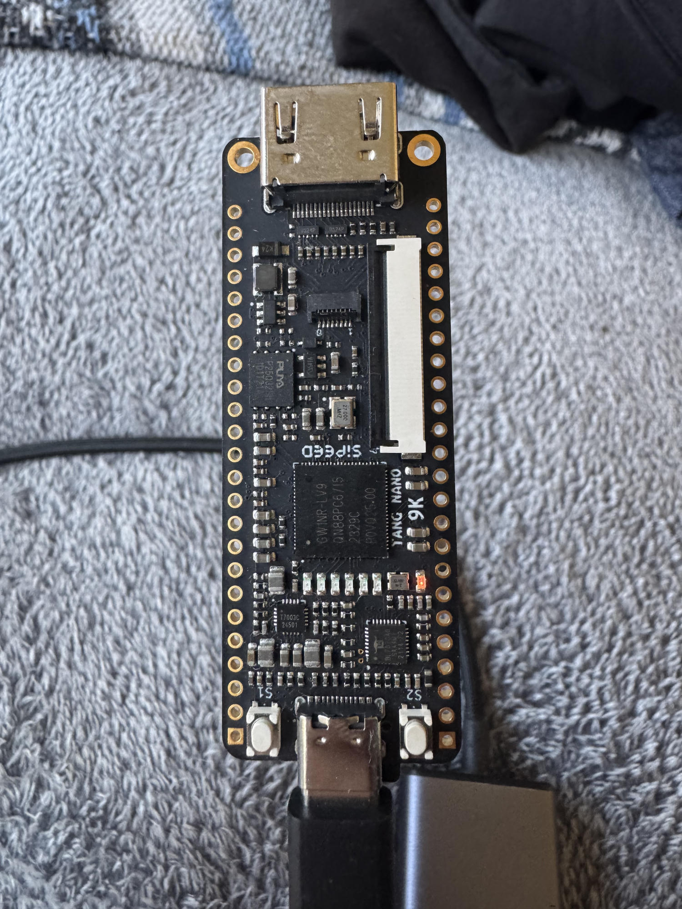
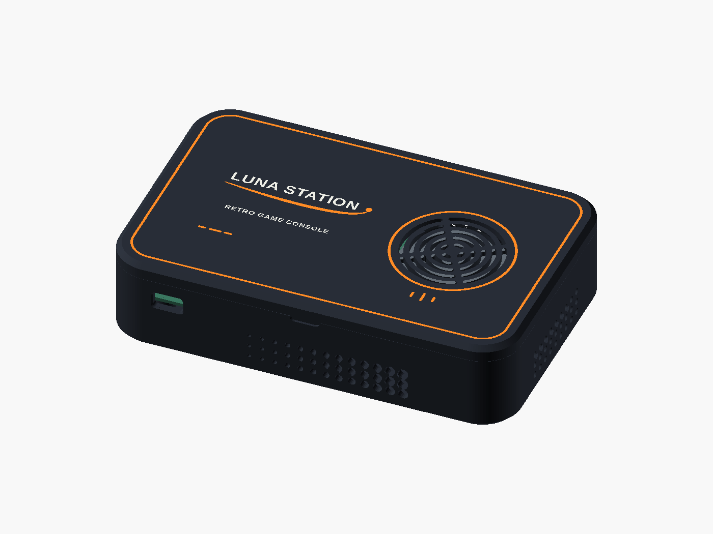
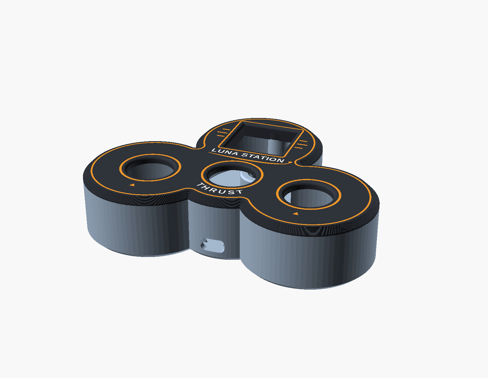

<p align="center">
  
</p>

<h1 align="center">Luna Station</h1>

<p align="center"><strong>A homemade retro console, built on an FPGA</strong><br>
RISC-V · HDMI · wireless gamepads · Lunar Lander</p>

Luna Station is a **hobby project** created to celebrate the 60th anniversary
of Luna 9's first successful soft landing on the Moon on 3 February 1966, and
for demonstration at the **Retro Computer Festival 2026 in Cambridge**.

The small console is built around the **Sipeed Tang Nano 9K**. Instead of
starting with a ready-made computer, the project describes its processor,
memory, video and interfaces in hardware logic. Its first game, **Lunar
Lander**, challenges you to control your descent and land before the fuel
runs out.



*Exhibition artwork; the screenshots below show the actual game.*

## The game

| Main menu | Lunar Lander |
|:---:|:---:|
|  |  |

Rotate, fire the engine and aim for a flat landing pad. A safe landing earns
points; narrow pads have higher multipliers. The game features fixed-point
physics, a fuel gauge, speed and altitude instruments, and an attract mode
honouring the Luna 9 and Apollo 11 missions.

## The console and gamepads

| Tang Nano 9K board | Luna Station enclosure |
|:---:|:---:|
|  |  |
| The FPGA development board used by the console. | Orbital graphite case design, shown as a CAD render. |

<p align="center">
  
</p>

*Gamepad case design. The controller uses an ESP32 and ESP-NOW to send button
states to a receiver connected to the FPGA.*

- **FPGA:** Gowin GW1N(R)-9C on the Tang Nano 9K.
- **Processor:** [PicoRV32](third_party/picorv32/picorv32.v), a 32-bit RISC-V
  core running at 27 MHz, with 8 KiB of application RAM.
- **Video:** 640 × 480 at 60 Hz over HDMI; the hardware draws the terrain, HUD,
  Earth, stars and a lander with 32 orientations.
- **Games:** a bootloader reads game images from a FAT16/FAT32 SD card.
- **Audio:** an ESP32 synthesizes music and effects, output through a
  MAX98357A I²S amplifier.
- **Controllers:** ESP32-based wireless gamepads, with 3D-printable cases and
  an optional LED matrix.

The electronics and game have been tested on hardware, but this remains a
work in progress. The enclosure is a design/fit-test project, not a fully
validated production case. Check the wiring and fit for your own components.

## Play

On the wireless gamepad, use the left/right buttons to rotate, thrust to start
or fire the engine, and menu to go back. A USB-UART keyboard bridge is also
available: **A/D** or **Left/Right** rotate, **W/Up/Space** starts or thrusts,
and **B/Escape** opens the menu.

See the [controller and audio firmware](examples/espnow-counter/README.md) and
[assembly guide](docs/04_ASSEMBLY_AND_CONNECTIONS.md) for connections.

## Build

The console build requires Python 3 with Pillow, Icarus Verilog, Verilator,
a RISC-V bare-metal GCC toolchain supporting `rv32i/ilp32`, and an OSS CAD
Suite containing Yosys, nextpnr-himbaechel and gowin_pack. `openFPGALoader`
is used to program the board. See the [development setup](docs/02_DEVELOPMENT_SETUP.md)
and [build guide](docs/10_BUILD_AND_UPDATE.md) for details.

```sh
git clone https://github.com/melrouts/RetroConsole-LunaStation.git
cd RetroConsole-LunaStation

# Point this to your OSS CAD Suite installation.
export OSS_CAD_SUITE=/path/to/oss-cad-suite
make images
make console-bitstream
```

The game image is produced at `build/images/LUNAR.BIN` and the console
bitstream at `build/console.fs`. See the [SD card format and deployment
guide](docs/08_SD_CARD_FORMAT.md) before copying games or programming hardware.
Programming flash changes the board's persistent configuration: follow the
build guide and make your own backup first.

The historical third-party browser reference `index.html` is not included.
The optional trajectory comparison against that file is skipped when it is
absent; the remaining console tests can still run. Local build outputs,
device backups and historical release binaries are not included.

## Explore the project

| Path | Contents |
|---|---|
| [`rtl/`](rtl/) | FPGA system, video, SD and serial interfaces |
| [`firmware/`](firmware/) | RISC-V bootloader and Lunar Lander |
| [`examples/espnow-counter/`](examples/espnow-counter/) | ESP32 controller, receiver and audio firmware |
| [`hardware/luna-station-case/`](hardware/luna-station-case/) | Console case design, STL/3MF files and previews |
| [`hardware/gamepad-power-holder/`](hardware/gamepad-power-holder/) | Gamepad case, power holder and LED-matrix designs |
| [`hardware/esp32-tang-uart-wiring.png`](hardware/esp32-tang-uart-wiring.png) | FPGA-to-ESP32 wiring diagram |
| [`docs/`](docs/) | Hardware, software, assembly and verification documentation |
| [`exhibition/LunarLander-exhibit-A4.pdf`](exhibition/LunarLander-exhibit-A4.pdf) | Printable A4 exhibition sheet |
| [`exhibition/LunaStation-booklet-A5.pdf`](exhibition/LunaStation-booklet-A5.pdf) | Folded booklet: print on both sides of A4, flip on the short edge |
| [`README.ru.md`](README.ru.md) | Detailed development notes in Russian |

## Credits and reuse

The Luna 9 capsule photograph is by Stolbovsky, [CC BY 4.0](https://creativecommons.org/licenses/by/4.0/);
the Apollo 11 image is from NASA. See [photo credits](photos/README.md).
PicoRV32 and the bitmap font retain their upstream notices in `third_party/`;
the exhibition fonts include their SIL Open Font Licenses in `exhibition/`.
No project-wide license has been specified.
