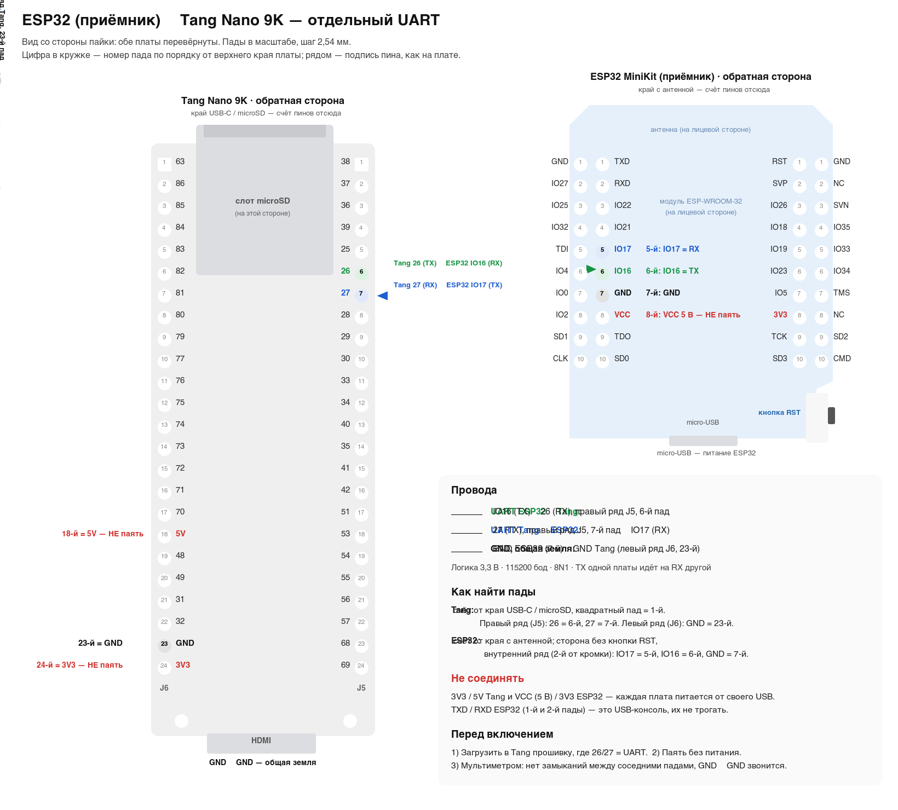
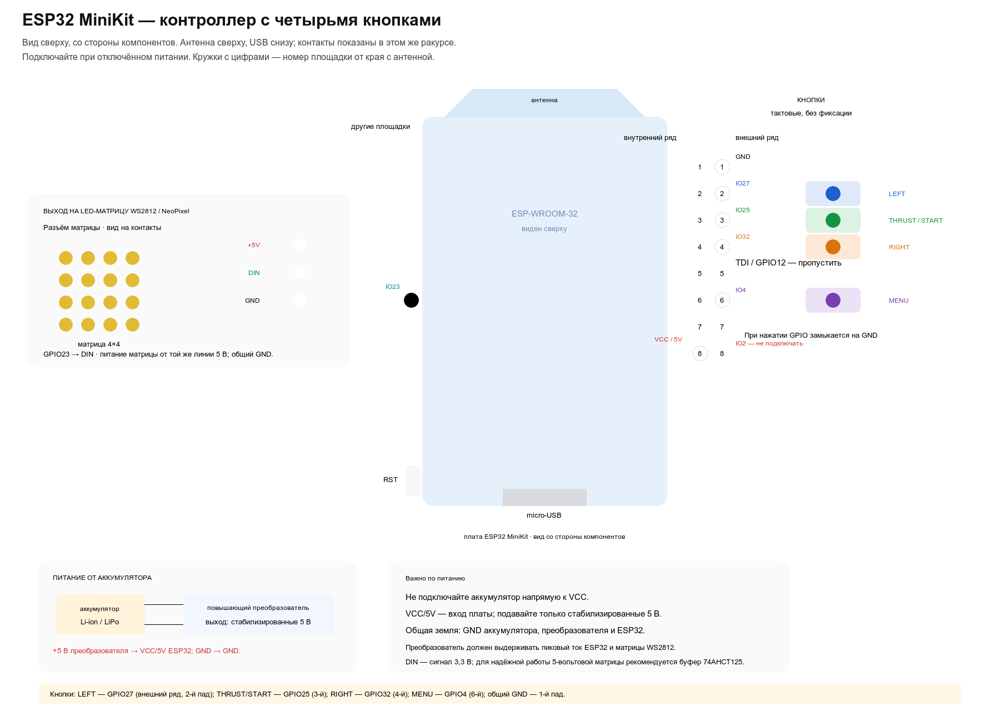
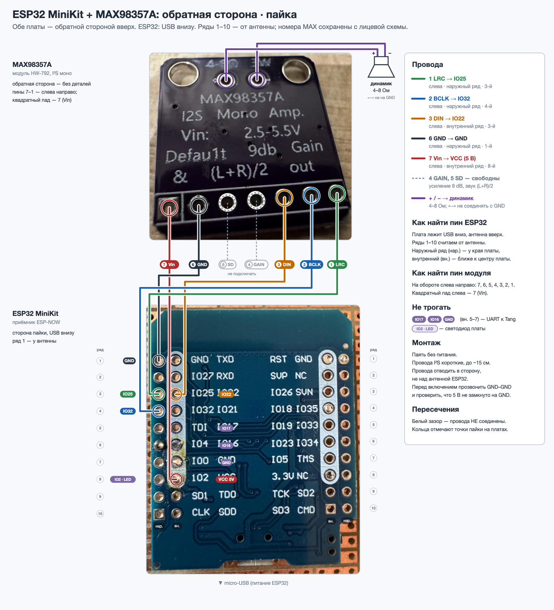

# Сборка и подключение консоли

## 1. Важное правило

Номера пинов, напряжения и направления сигналов брать только из официального
schematic/pinout конкретной ревизии Tang Nano 9K. На фотографии обратной стороны
платы в `hardware/board-photos/` видна маркировка `3674`; соответствующая схема
и сверенные package pin numbers приведены в `03_HARDWARE_PLAN.md`. Таблица
отражает board package pins, а не физическую нумерацию header pads.
Не использовать непроверенные таблицы из интернета.

## 2. Комплект

- Tang Nano 9K;
- USB кабель;
- HDMI кабель и монитор;
- microSD карта;
- четыре momentary push buttons;
- breadboard и провода;
- resistor network для кнопок;
- усилитель MAX98357A (HW-792) и один подходящий динамик 4–8 Ом;
- общий стабилизированный источник 5 В с достаточным запасом по току.

## 3. HDMI

Подключить штатный HDMI выход платы к монитору. Для baseline official example
проверены TMDS pairs `71/70`, `73/72`, `75/74` и clock `69/68`; перед созданием
constraints сверить их с PDF именно установленного варианта. Проверка
начинается с test pattern, затем font, затем game compositor.

## 4. SD

На плате виден штатный microSD-разъем. Схема 3674 подтверждает package pins:
SCLK 36, MOSI 37, CS 38, MISO 39 (ссылки в `03_HARDWARE_PLAN.md`).
PicoTiny constraints этих сигналов не задают. Перед добавлением карты в
constraints проверить IO type и VCCO; не подменять внутренний слот внешним
SPI-модулем. Если
будет выбран внешний SPI SD-модуль, сначала определить четыре data/control GPIO,
3.3 V питание и общий ground по schematic/connector pinout, затем добавить их
в constraints. SD-карта должна быть отформатирована FAT16/FAT32 и содержать
validated package; firmware update не должен автоматически форматировать карту.

## 5. Отдельный UART для ESP32

Для внешнего UART используются контакты J5.6 и J5.7: FPGA выводы 26 и 27,
банк 3,3 В. J5.5 (вывод 25) остаётся свободным. Это отдельные сигналы; USB-UART на FPGA выводах 17/18 остается
нетронутым. Подключать UART крест-накрест:



Исходник схемы: [esp32-tang-uart-wiring.svg](../hardware/esp32-tang-uart-wiring.svg).

На схеме обе платы показаны со стороны пайки, пады в масштабе (шаг 2,54 мм) и
пронумерованы от верхнего края. Tang расположен краем USB-C/microSD вверх,
квадратный пад в этом ряду — 1-й. ESP32 MiniKit расположен антенной вверх,
кнопка RST при этом оказывается справа внизу.

| Tang Nano 9K | ESP32-WROOM-32 receiver |
| --- | --- |
| J5.6 / FPGA 26 / `link_uart_tx`: правый ряд, 6-й пад | GPIO16 / UART2 RX: внутренний ряд со стороны без RST, 6-й пад |
| J5.7 / FPGA 27 / `link_uart_rx`: правый ряд, 7-й пад | GPIO17 / UART2 TX: тот же ряд, 5-й пад |
| J6.23 / GND: левый ряд, 23-й пад (24-й — 3V3) | GND: тот же ряд, 7-й пад (8-й — VCC 5 В) |

Питание ESP32 оставить от USB. Не соединять VCC плат и не подключать UART к
5 В. Выполнять монтаж при отключенном питании. Приёмник ESP32 пересылает каждую
принятую маску кнопок в UART2 (115200 8N1, RX=GPIO16, TX=GPIO17) байтом
`0x80 | held_mask`. Перед отправкой приёмник меняет местами биты 1 и 2
(THRUST и RIGHT); остальные биты не меняются. В журнале `RX buttons` содержит
исходную маску, а `TANG TX buttons` — преобразованную. USB-клавиатура не
переназначается. `RX` и `TANG TX` в USB-Serial показывают приём и постановку
байта в очередь UART, но не подтверждение от FPGA. Через 250 мс без пакетов
удерживаемые кнопки отпускаются. Эхо кнопок от Tang логируется как `TANG RX`;
в новой прошивке изменения игрового аудиосостояния логируются как
`AUDIO GAME scene=… mode=… thrust=…`.
RTL принимает кнопки на RX отдельного порта (FPGA27); ответный TX выведен на
FPGA26. Состояния USB-UART и
ESP32 объединяются через OR перед формированием press/release событий:
повторы held не создают новых нажатий, отпускание одного источника не снимает
кнопку, удерживаемую другим. Каждый источник имеет независимый таймаут 250 мс.
TX Tang (FPGA26) возвращает принятый корректный байт кнопок без изменений.
`TANG RX byte=0x82` в USB-Serial приёмника подтверждает, что FPGA приняла
маску THRUST. Это подтверждение UART, а не состояния игры; обратная
телеметрия движения не реализована. Копия принятого байта выводится также
в USB-UART Tang строкой `RX 0x82`, между обычными отчётами `PASS`/`FAIL`.
Если есть `TANG TX`, но нет `RX` на Tang и `TANG RX` на ESP32,
проверить оба перекрёстных UART-провода и общую землю.

### Проверка связи и текущий аппаратный статус

`PASS` — отчёт работоспособности консоли, а не подтверждение получения
кнопок. Неподключённый UART с подтяжкой может не давать ошибок и не мешать
отчётам `PASS`. Для THRUST ожидается следующая цепочка:

| Где смотреть | Ожидаемый лог |
| --- | --- |
| USB-Serial передатчика | `TX ... buttons=0x04 RIGHT` (имя исходного бита) |
| USB-Serial приёмника | `RX ... buttons=0x04`, затем `TANG TX byte=0x82 buttons=0x02 raw=0x04` |
| USB-UART Tang | `RX 0x82` |
| USB-Serial приёмника, обратное эхо | `TANG RX byte=0x82` |

На проверке 2026-11-04 прежнее назначение RX=GPIO17, TX=GPIO16 обеспечивало
UART-эхо `0x84`. Текущее назначение намеренно переставляет UART на обоих концах:
Tang RX=FPGA27/TX=FPGA26, ESP32 RX=GPIO16/TX=GPIO17. Его нужно проверять
совместно с текущей проводкой; реакцию самой игры проверять отдельно.
Раздельное питание от USB не заменяет провод общей земли.

На раннем этапе диагностическая прошивка загружалась в SRAM. Позднее звуковая
сборка была записана во внутреннюю configuration flash. Для временной
проверки другого совместимого bitstream можно загрузить его в SRAM:

```sh
openFPGALoader -b tangnano9k --write-sram build/console.fs
```

При старте обоих ESP32 наблюдался brownout-сброс, после которого работа
продолжалась. Проверить USB-кабели и питание; защиту от просадки не отключать.
Обратная передача статуса движения ещё не реализована: анимация матрицы
передатчика получает случайное демо от приёмника.

## 6. Кнопки

Логические кнопки:

```text
LEFT
THRUST
RIGHT
MENU/BACK
```

Рекомендуемая схема: input GPIO с internal/external pull-up и кнопка на ground. Точную схему выбрать после проверки voltage levels платы. Не оставлять GPIO floating.

Перед включением проверить continuity и отсутствие короткого замыкания между питанием и ground.

Подробная схема четырех кнопок и проверенные предлагаемые назначения J5.5–J5.8
(FPGA 25–28), GND/3V3 и статус поддержки:
[13_BUTTONS_AND_HARDWARE_RELEASE.md](13_BUTTONS_AND_HARDWARE_RELEASE.md).
В этой сборке J5.6 и J5.7 заняты отдельным UART для ESP32. Кнопки для игрового
управления планируются беспроводными; не использовать эти UART-контакты для
кнопок.

### Кнопки на ESP32-передатчике

Четыре тактовые кнопки без фиксации подключаются к ESP32-передатчику: одна
ножка каждой кнопки — к своему GPIO, вторая — к общему GND. Подтяжка
внутренняя (`INPUT_PULLUP`), внешние резисторы не нужны: отпущена = 1,
нажата = 0. У кнопки 6×6 мм с четырьмя ножками использовать две ножки по
диагонали.



Исходник схемы: [esp32-tx-buttons-wiring.svg](../hardware/esp32-tx-buttons-wiring.svg).

На обновлённой схеме плата показана сверху, со стороны компонентов, антенной
вверх. Все кнопки — на внешнем ряду стороны без кнопки RST; номера площадок
считаются от края с антенной:

| Действие на Tang | Бит `held_mask` после приёмника | ESP32 GPIO | Пад MiniKit |
| --- | --- | --- | --- |
| LEFT | 0 | GPIO27 | 2-й |
| THRUST/START | 1 | GPIO25 | 3-й |
| RIGHT | 2 | GPIO32 | 4-й |
| MENU | 3 | GPIO4 | 6-й (5-й, TDI/GPIO12, пропустить) |
| общий GND | — | GND | 1-й |

Названия битов в журнале передатчика относятся к исходному пакету, до
перестановки битов на приёмнике.

Для питания от аккумулятора используйте повышающий преобразователь с
регулируемым выходом **5 В**: выход `+5V` преобразователя подключить к `VCC/5V`
ESP32 (внутренний ряд, 8-й пад), `GND` — к GND ESP32. Не подключать
одноэлементный Li-ion/LiPo аккумулятор напрямую к `VCC`; его напряжение не
стабилизировано на 5 В. Линия `VCC` уже питает матрицу WS2812, поэтому
преобразователь должен выдерживать пиковый ток ESP32 и матрицы. Пунктирная
трасса питания на схеме проложена с обратной стороны платы; изолируйте её от
соседних площадок.

Матрица WS2812/NeoPixel 4×4 подключается отдельным трёхпроводным выходом:
`DIN` — к GPIO23 (внутренний ряд противоположной стороны, 6-й пад от антенны),
`+5V` — к стабилизированному выходу преобразователя, `GND` — к общей земле.
GPIO23 выдаёт логический сигнал 3,3 В; для надёжной работы 5-вольтовой матрицы
рекомендуется буфер уровня 74AHCT125. Не подавать 5 В на GPIO ESP32.

Не использовать strapping-пины GPIO0, GPIO2, GPIO5, GPIO12 (TDI) и GPIO15
(TDO), TXD/RXD USB-консоли, а также GPIO23 и VCC, уже занятые матрицей WS2812.
Прошивка передатчика опрашивает кнопки с подавлением дребезга 20 мс и
передаёт полную четырёхбитную маску по ESP-NOW при нажатии или отпускании.
Удерживаемые кнопки повторяются каждые 100 мс. Передача кнопок активна
сразу после включения, даже без приёмника; `start`/`stop` управляют только
демонстрационным счётчиком. Serial выводит маску и имена всех нажатых кнопок.

Можно использовать несколько контроллеров (до четырёх): приёмник различает
их по MAC. В меню, на заставках и в демо работают кнопки всех контроллеров;
игроком становится тот, чей THRUST запустил игру. Во время игры, включая
GAME OVER, кнопки остальных игнорируются, при возврате в главное меню выбор
игрока сбрасывается. Подробности —
[описание ESP-NOW](../examples/espnow-counter/README.md#several-controllers).

## 7. Audio

### ESP32-приёмник и MAX98357A

Приёмник ESP32 подключён к цифровому моноусилителю MAX98357A (HW-792) по I²S.
На плате проверена тестовая трёхнотная мелодия; пользователь подтвердил, что
её слышно, и подобрал текущую громкость. Новая сборка также связывает музыку и
эффекты с состоянием игры через UART. Прошивка приёмника, FPGA и игра
обновлены; пользователь подтвердил музыку и тягу в игре, а громкость
демонстрации эффектов признал подходящей. Уровни музыки (громче на главном
экране, заставках и в демо, тише в игре) добавлены позже. Пользователь
прослушал шестиголосную композицию при уровнях 1,4/1,05 и сообщил, что она всё
ещё тихая, хотя остальные звуки нормальные. Уровни 1,45/1,3 прошли тесты
микшера и прошиты в ESP32; результат нового прослушивания ещё не получен.
Старые регистры `AUDIO_CONTROL` и `AUDIO_PERIOD`
по-прежнему диагностические и не управляют аудиосигналом.



[Редактируемая схема](../hardware/esp32-max98357a/esp32-max98357a-back-photo-wiring.svg),
[вид со стороны компонентов](../hardware/esp32-max98357a/esp32-max98357a-photo-wiring.png)
и [общая схема](../hardware/esp32-max98357a/esp32-max98357a-wiring.png).
Исходные фотографии сохранены в `hardware/esp32-max98357a/photos/`.

Для платы MiniKit на фото: обе платы стороной пайки вверх, USB ESP32 внизу,
ряды площадок считаются от антенны.

| MAX98357A | ESP32-приёмник | Площадка ESP32 на фото |
| --- | --- | --- |
| 1 LRC | GPIO25 | слева, наружный ряд, 3-я |
| 2 BCLK | GPIO32 | слева, наружный ряд, 4-я |
| 3 DIN | GPIO22 | слева, внутренний ряд, 3-я |
| 4 GAIN, 5 SD | не подключены | настройки модуля по умолчанию |
| 6 GND | GND | слева, наружный ряд, 1-я |
| 7 Vin | VCC / 5 В | слева, внутренний ряд, 8-я |
| Выходы `+` и `−` | динамик между выходами | не подключать к GPIO или GND |

У модуля на фото свободный GAIN соответствует усилению 9 dB, а свободный SD —
моносмеси `(L+R)/2`. GPIO16/17 остаются для UART к Tang, GPIO2 — для
светодиода приёмника. Питание MAX98357A берётся от 5 В ESP32, сигналы GPIO —
3,3 В. При раздельном USB-питании Tang и ESP32 нужна общая земля для UART;
не соединять их 5-вольтовые шины напрямую.

**Динамик подключать только между `+` и `−` усилителя.** Это мостовой выход:
ни один из выводов динамика нельзя соединять с GND. Использовать динамик с
подходящими сопротивлением и мощностью. При 5 В усилитель способен превысить
номинал маломощного динамика 0,5 Вт; ограничение в прошивке само по себе не
гарантирует его защиту.

Монтаж менять только при выключенном питании. Перед включением проверить
полярность, общую землю и отсутствие короткого замыкания между 5 В и GND.
Провода I²S желательно оставить короткими. При нескольких стартах журнал
сообщал `Brownout detector was triggered`, после перезапуска приёмник работал.
При повторении проверить питание и USB-кабель; защиту от просадки не отключать.

#### Проверка и громкость

Прошивка находится в `examples/espnow-counter/espnow-counter-rx/`.
При включении она проигрывает мелодию; для повтора отправить `sound` в
USB Serial Monitor на 115200 baud. Команда `status` показывает `audio=ready`,
если драйвер и аудиозадача готовы, но не подтверждает подключение динамика
или фактическое воспроизведение. Этот интерфейс относится к USB-Serial ESP32;
UART между Tang и ESP32 команду `sound` не обрабатывает.
В новой прошивке `audio-demo` запускает примерно на 6,2 секунды музыку главного
экрана, полёт, двигатель, посадку и аварию, временно заменяя игровое
аудиосостояние.
При замене ESP32-приёмника нужно отдельно загрузить на другую плату актуальную
прошивку и проверить `status`: одинаковые платы не обязательно прошиты
одинаково.

Передаются одинаковые левый и правый каналы: I²S Philips, 16 бит, 16 кГц.
Текущий пик `StartupChime::PEAK = 7500` из 32767 (около 22,9% цифровой
шкалы). Тот же предел применяется к итоговому игровому миксу. Для изменения
громкости отредактировать это значение в
`startup_chime.h` и перепрошить приёмник: меньшее значение в диапазоне
0–32767 даёт более тихий сигнал. Итоговая громкость и допустимый уровень
зависят от усилителя и динамика. Команды сборки и прошивки приведены в
[описании ESP-NOW](../examples/espnow-counter/README.md#receiver-audio-max98357a).
Вызов из программы на компьютере и интерфейс для игр описаны в
[плане ПО](09_SOFTWARE_PLAN.md).

## 8. Последовательность проверки

Текущий bring-up проверил USB/JTAG, CPU/RAM/MMIO и UART 115200 через временный
SRAM bitstream. Он не подтверждает continuity внешнего монтажа, HDMI lock,
SD, кнопки или игровой звук. Для новой игровой сборки музыка и тяга проверены
на слух; проверка остальных игровых событий описана выше.
Для этого top внешние цепи не требуются; подключение
UART к onboard debugger уже выполнено на плате.

1. Осмотреть монтаж.
2. Проверить ground.
3. Проверить resistance power-to-ground при выключенной плате.
4. Подключить только USB и HDMI.
5. Записать test pattern.
6. Подключить SD.
7. Проверить bootloader.
8. Подключить кнопки.
9. Проверить input test screen.
10. Подключить audio stage.
11. Проверить test tone.
12. Запустить игру.

## 9. Safety

- Работать на непроводящей поверхности и не касаться FPGA/GPIO после накопления статического заряда; при пайке использовать ESD-защиту и заземленный ESD-safe инструмент.
- Хранить плату в anti-static bag при отключенном питании.
- Не превышать GPIO voltage/current.
- Не подавать внешнее напряжение на выход FPGA.
- Не подключать динамик напрямую к GPIO.
- Не менять wiring при включенном питании.
- При неизвестном pinout остановить сборку до проверки документации.
