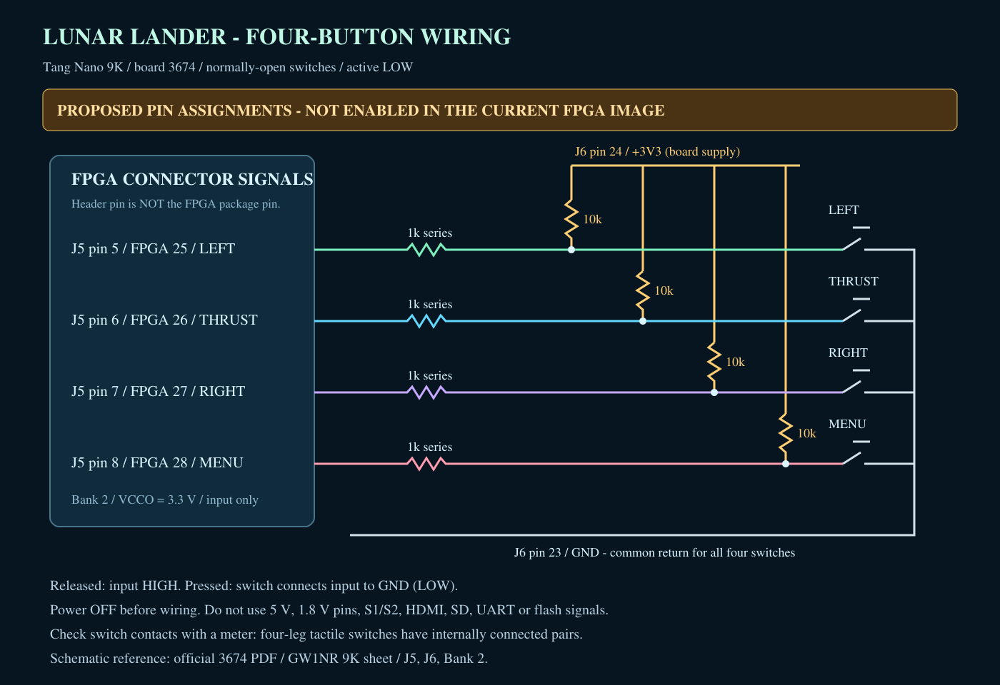

# Внешние кнопки и готовность постоянной прошивки

## Текущий статус

В установленном console bitstream управление приходит только через USB-UART.
`rtl/console_core.sv` подключает `uart_buttons` к INPUT_STATE/INPUT_EVENT.
`hardware/tangnano9k-console.cst` не содержит внешних игровых кнопок.
В проекте есть проверенный `button_debounce.sv`, но он пока не подключен
к console top. Поэтому подключение проводов по схеме ниже **само по себе
не включит кнопки в текущей прошивке**.

Аппаратная платформа еще не зафиксирована как законченная; физические кнопки
по-прежнему не подключены в RTL. Однако 2026-11-02 пользователь отдельно
попросил записать текущую рабочую версию перед отключением питания.
Telemetry build установлен во **внутреннюю configuration flash**, выполнены
CRC check и reload без SRAM load с двумя свежими PASS от SD game.
Внешняя SPI flash не менялась. Подробности и файлы восстановления:
`10_BUILD_AND_UPDATE.md`, раздел 10. Это постоянная рабочая версия,
не объявление полного аппаратного release.

## Предлагаемая схема подключения

Следующие четыре кнопочных назначения оставлены как исторически проверенная
вариация, но не используются для текущего беспроводного управления. В
console bitstream контакты J5.6 и J5.7 теперь выделены под отдельный UART
Tang–ESP32; см. `04_ASSEMBLY_AND_CONNECTIONS.md`.

Редактируемый оригинал: [buttons-wiring.svg](buttons-wiring.svg).
Схема показывает электрические соединения, а не физический вид/ориентацию платы.
Не отсчитывать отверстия по рисунку: найти начало J5/J6 по официальному pinmap
и проверить мультиметром перед пайкой. Номер контакта разъема отличается от
номера вывода корпуса FPGA.

| Кнопка | Контакт разъема | Вывод FPGA | Имя в схеме | INPUT_STATE |
| --- | --- | --- | --- | --- |
| LEFT | J5.5 | 25 | IOB8A | bit 0 |
| THRUST / START | J5.6 | 26 | IOB8B | bit 1 |
| RIGHT | J5.7 | 27 | IOB11A | bit 2 |
| MENU / BACK | J5.8 | 28 | IOB11B | bit 3 |
| Общий провод | J6.23 | — | GND | — |
| Питание подтяжек | J6.24 | — | +3V3 | — |

Это **предлагаемые новые назначения**, не действующие constraints.
Проверены по официальной схеме 3674: лист `/GW1NR 9K/`, разъемы J5/J6,
выводы U5 и питание BANK2 = VCCO0_1_2_3V3. В текущих console constraints
26 и 27 заняты отдельным UART ESP32, 25 и 28 свободны; группа не пересекается
с USB-UART 17/18, SD 36–39, HDMI 68–75 или SPI flash 59–62.
Тестовый MAX98357A подключён к GPIO ESP32-приёмника и не занимает эти пины
Tang. Подключение описано в `04_ASSEMBLY_AND_CONNECTIONS.md`, раздел Audio.

Источник:
[Tang_nano_9K_3674_schematics.pdf](https://dl.sipeed.com/TANG/Nano%209K/2_Schematic/Tang_nano_9K_3674_schematics.pdf).
Фотографии платы: `hardware/board-photos/`. При несовпадении ревизии или
нумерации остановить монтаж, не переносить назначения на другую плату наугад.

На каждый канал:

1. GPIO через последовательный резистор 1 кОм соединить с сигнальным узлом.
2. От узла поставить резистор 10 кОм к **3.3 V самой платы**.
3. Нормально разомкнутую кнопку соединить между узлом и общим GND.

Нажатие дает LOW, отпускание HIGH. Последовательный резистор ограничивает
ток при ошибке конфигурации, но не делает GPIO устойчивым к 5 V.
Во входном режиме он практически не меняет уровень сигнала.
Каждая кнопка имеет отдельную подтяжку; все четыре используют общий GND.
Для коротких проводов дополнительный конденсатор не обязателен: дребезг
планируется обрабатывать цифровым фильтром. Для длинного кабеля требуется
отдельная проверка помех/ESD, эта схема ее не заменяет.

**Подключать при выключенном питании.** Не брать 5 V или питание 1.8 V,
не использовать S1/S2, JTAG/MODE/RECONFIG и занятые периферией выводы.
У четырехвыводной тактовой кнопки контакты объединены попарно внутри корпуса;
пары определить прозвонкой. Взять контакты, которые замыкаются только при нажатии.

До загрузки bitstream с назначенными входами монтаж не считать принятым.
При отключенной плате проверить отсутствие короткого замыкания 3V3–GND,
правильную землю и соответствие каждого провода разъему.

## Что нужно закончить перед записью во flash

1. Подключить четыре active-low входа в console wrapper/core, назначить
   LVCMOS33 constraints, добавить 2FF synchronization и debounce.
2. Объединить физические и UART-кнопки без потери press/release events:
   отпускание одного источника не должно отпускать кнопку, удерживаемую другим.
   Во время UART update физические события не должны запускать игру.
3. Проверить все четыре кнопки, удержание/одновременные нажатия, старт,
   подтверждение/отмену выхода и восстановление после update на реальной плате.
4. Проверить HDMI после cold boot, SD boot и COM update. В предыдущем
   memorial build было предупреждение о partially-global serial clock routing;
   в новом telemetry placement оно не появилось. Полный
   clock/hold/recovery sign-off еще не выполнен.
5. Для полного release подготовить процедуру сохранения/восстановления
   внутренней configuration flash и cold-power-cycle тест. Внешняя 4 MiB
   flash — другая память; ее dump не является backup FPGA configuration.
   E26 flash-manager с другим layout нельзя использовать как готовую
   процедуру Lunar Lander. Текущий loader проверяет configuration checksum,
   но не поддерживает побайтовый readback внутренней flash.

После этого можно зафиксировать постоянную FPGA-платформу и загружать
совместимые game BIN по COM в A/B slots SD без дальнейшей записи FPGA.
Сейчас работают постоянная configuration flash и SD update slots;
после включения FPGA должна загрузить установленный renderer, а bootloader —
игру с SD. JTAG reload это подтвердил; физическое отключение/включение питания
пользователем еще не наблюдалось.

## Что можно менять только через BIN

В текущей архитектуре только через game BIN меняются физика, баланс,
очки, логика игрового цикла, поведение автопилота и длительность состояний.
Шрифты, фотографии, их подписи, dashboard, compositor и новые MMIO-функции
сейчас находятся в RTL/ROM FPGA. Для их изменения потребуется новый bitstream.
Все 26 BSRAM уже заняты; PSRAM не используется.

Если требование «больше никогда не менять FPGA, включая картинки и текст»
буквальное, до аппаратного freeze нужен иной asset interface (например,
SD/PSRAM-backed graphics). Сейчас обещать такую возможность нельзя.

## Приоритетные улучшения

- До hardware freeze: внешние кнопки, проверяемое восстановление flash и
  надежный cold boot. Это важнее новых эффектов.
- После freeze, через BIN: настройка сложности, более аккуратный demo-автопилот,
  тренировка посадки и улучшение баланса топлива/очков в пределах имеющегося UI.
- Игровой звук установлен в FPGA, BIN и ESP32; пользователь подтвердил музыку
  и тягу в игре и громкость демонстрации эффектов. BIN может менять
  публикуемые состояния; сам синтез остаётся в прошивке ESP32.
- Отдельная будущая работа: рекорд на SD и загружаемые с SD картинки/тексты;
  нынешнего BIN-only интерфейса для них недостаточно.
