# Держатель питания геймпада

Держатель для LiPo EEMB LP903042 (3,7 В, 1100 мА·ч, ≈30×45×9 мм) и модуля
заряда/повышения LN4056H с USB-C (≈23,0×17,5 мм). Фото комплектующих:
[`IMG_6783.jpeg`](../../IMG_6783.jpeg).

## Папки версий

| Папка | Содержимое |
|---|---|
| [`v1/`](v1/) | Универсальный держатель и первая версия корпуса со скруглением R1 |
| [`v2/`](v2/) | Более тонкие рукоятки и нижний центральный отсек |
| [`v3/`](v3/) | Отдельный держатель с увеличенными карманами зарядной платы и ESP32 |
| [`v4/`](v4/) | Всё в одном корпусе высотой 30 мм и крышка с увеличенными отверстиями |
| [`v5/`](v5/) | Корпус V4 с исправленными магнитами и нижней кнопкой; декоративная крышка «Luna station» для многоцветной печати |
| [`v6/`](v6/) | Корпус V5 без изменений; крышка с фаской 45° по краю, классической разметкой и креплением LED-матрицы |
| [`v7/`](v7/) | Корпус 31 мм: дно толще на 1 мм, фаска 45° по нижней кромке, две канавки по контуру на дне; крышка V6 |
| [`v8/`](v8/) | Пластина 3,5 мм для LED-матрицы 30×30 мм: матрица винтами M2 к пластине, пластина болтами M2 к стойкам крышки V6; крышка V6 и корпус V7 без изменений |
| [`originals/`](originals/) | Неизменённые исходные STL корпуса и крышки |

STL, исходники OpenSCAD, скрипты подготовки и превью лежат в папке своей
версии. Новые версии используют модули предыдущих: для пересборки
сохраняйте папки рядом. Все команды ниже выполняются из
`hardware/gamepad-power-holder/`.

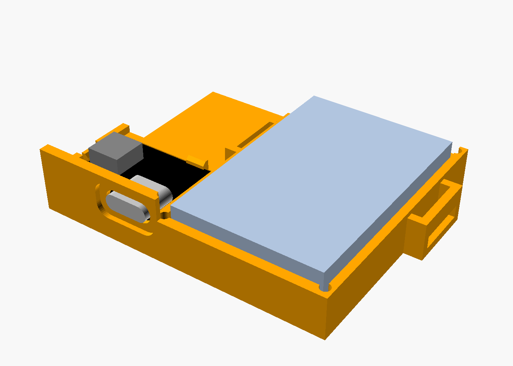

| Файл | Назначение |
|---|---|
| `v1/gamepad_power_holder.scad` | Параметрический исходник (OpenSCAD) |
| `v1/gamepad_power_holder.stl` | Держатель, 63,3×50,1×13,0 мм |
| `v1/usb_c_case_cutter.stl` | Тело выреза под USB-C для стенки корпуса |

## Версия 8: пластина крепления LED-матрицы

Плата матрицы (30×30×1,5 мм, отверстия Ø3–4 мм на квадрате 16×16 мм) меньше
окна крышки 32×32 мм и не достаёт до стоек V6 (40×24 мм). Пластина соединяет
их: к стойкам крышки она крепится четырьмя болтами M2, а матрица к ней —
четырьмя винтами M2. Крышка V6 и корпус V7 не менялись.

| Что | V8 |
|---|---|
| Пластина | 48×32×3,5 мм (`plate_t`), контур со скруглением R4 вокруг стоек крышки; верхняя грань (Z 130) ложится на торцы четырёх стоек и упоров крышки, контакт ≈110 мм² |
| Крепление к крышке | 4 болта M2×6 со стороны корпуса: отверстие Ø2,4 мм, под головку зенковка Ø4,4×2 мм; болт входит в вплавляемую гайку на 4,5 мм из 5 |
| Крепление матрицы | 4 стойки Ø6×4,2 мм на квадрате 16×16 мм; в каждой карман Ø3,2×4,5 мм под вплавляемую гайку M2 (стенка 1,4 мм); винты M2×5 со стороны светодиодов |
| Положение матрицы | светодиоды на 1,5 мм ниже лицевой поверхности крышки (`led_recess`); плата стоит в окне с зазором 1 мм по периметру |
| Провода | окно 10×10 мм в центре пластины |

Высоты: пластина 3,5 + стойка 4,2 + плата 1,5 + светодиод 1,6 + 1,5 мм до
лицевой поверхности = 12,3 мм. Чтобы утопить светодиоды глубже, увеличьте
`led_recess`: каждый +1 мм укорачивает стойки на 1 мм.

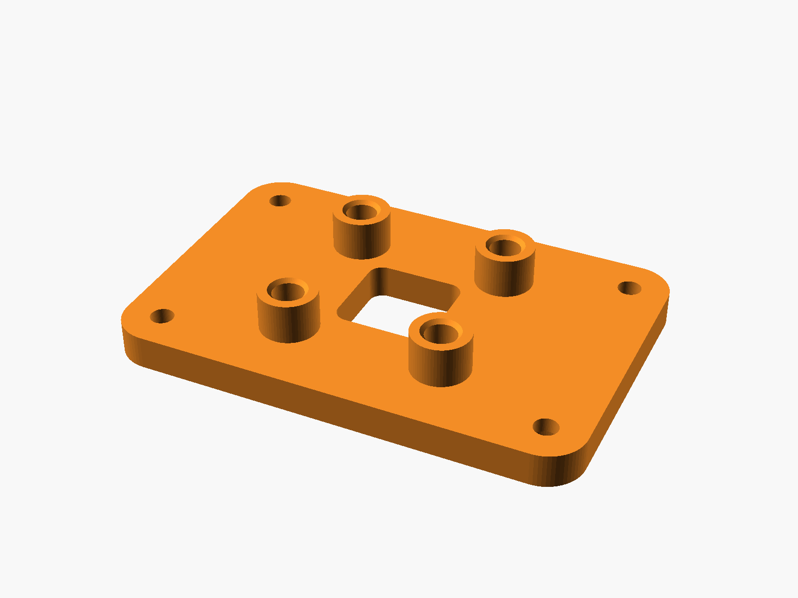

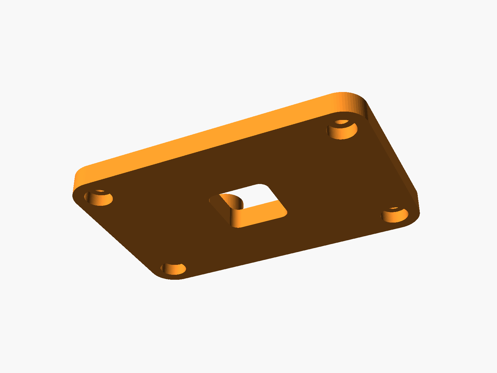

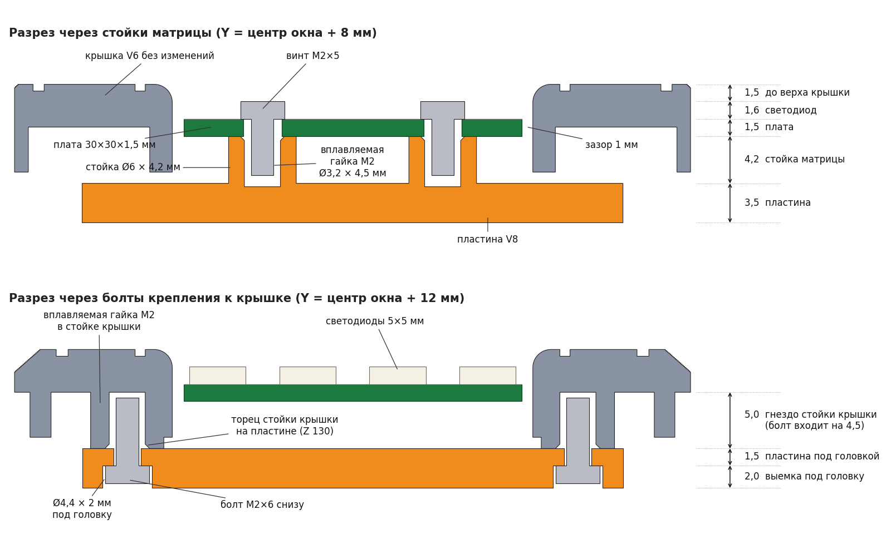

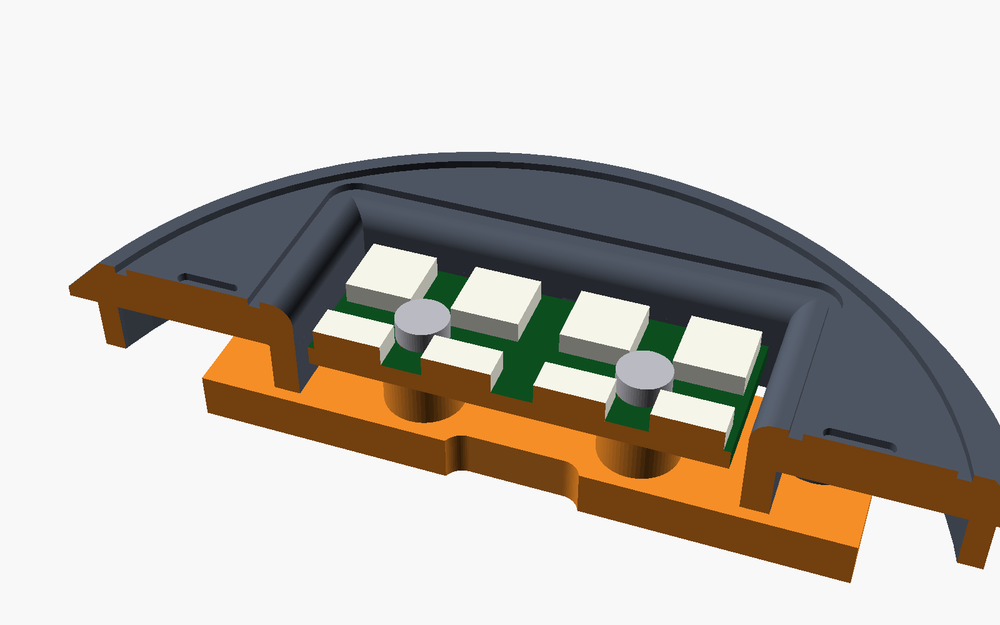

Проверено (`check_plate_v8.py`):

- пластина — одно замкнутое тело, печатается плоско;
- четыре отверстия Ø2,4 мм стоят точно под гайками Ø3,2 мм стоек крышки;
- торцы стоек крышки целиком лежат на пластине;
- стойки и матрица не касаются крышки: ближайшее место 1,00 мм;
- до стенок и магнитных стоек корпусов V7 и V5 ≥2,28 мм (нужно ≥0,6);
- низ пластины на 21,5–22,5 мм выше дна корпуса, а детали внутри не выше 13 мм.

Допущения:

- Ø отверстий матрицы замерен в диапазоне 3–4 мм; в превью — 3,4 мм. Головка
  M2 (Ø3,8–4,0 мм) прижмёт плату при отверстии ≤3,5 мм. Между светодиодами
  помещается головка до Ø≈4,2 мм (от отверстия до угла светодиода 2,12 мм),
  шайба Ø5 мм — нет;
- гайки M2 длиной до 4 мм (карман 4,5 мм);
- глубина светодиодов 1,5 мм — значение по умолчанию, не измерено.

Крепёж: 4 гайки M2 в стойки пластины (ещё 4 уже нужны в стойках крышки V6),
4 болта M2×6 (пластина — крышка) и 4 винта M2×5 (матрица — пластина), оба
типа с полукруглой головкой.

Сборка:

1. Вплавить гайки в стойки пластины и в стойки крышки.
2. Пластину положить стойками вверх, матрицу светодиодами вверх прикрутить
   винтами M2×5 и припаять провода.
3. Крышку положить лицом вниз и опустить пластину с матрицей: светодиоды
   входят в окно, пластина ложится на торцы стоек зенковками вверх.
4. Закрутить 4 болта M2×6 в гайки крышки.
5. Закрыть корпус крышкой.

Печать плоско, дно вниз, стойки вверх, поддержки не нужны (над зенковкой
Ø4,4 мм короткий мост). 3MF для V8 нет: деталь маленькая и одноцветная.

| Файл | Назначение |
|---|---|
| `v8/matrix_plate_v8.stl` | Пластина 48×32 мм в координатах крышки (Z 126,5–134,2); в слайсере ляжет дном на стол |
| `v8/matrix_plate_v8.scad` | Параметрическая пластина; `part` = `plate`, `board`, `screws`, `assembly` (с `cut=true` — разрез для превью) |
| `v8/check_plate_v8.py` | Проверка отверстий, контакта со стойками, зазоров до крышки и до корпусов V5/V7 (trimesh + shapely) |
| `v8/matrix_plate_v8_{top,underside,section,assembly}.png` | Превью |

```sh
"$OPENSCAD" --export-format binstl -o v8/matrix_plate_v8.stl v8/matrix_plate_v8.scad
python3 v8/check_plate_v8.py        # trimesh + shapely; рядом нужны v5/, v6/, v7/
```

## Версия 7: корпус с фаской и канавками на дне

Внутри всё как в V5: сечения выше дна совпадают. Под корпусом добавлен 1 мм
дна, поэтому высота 31 мм, а крышка — V6 без изменений.

| Что | V5 | V7 |
|---|---|---|
| Высота / дно | 30 мм / 1,5 мм | 31 мм / 2,5 мм |
| Нижняя кромка | скругление R2 | фаска 45°, 2,5 мм (`chamfer`); кончается ниже внутреннего дна |
| Дно | гладкое | 2 канавки по контуру: центры в 6 и 10,5 мм от края (`groove_insets`), глубина 1 мм, дно канавки 1 мм, стенки 45° (3 мм по поверхности) |
| Вход ниши нижней кнопки | скругление R1 | фаска 45°, 1,5 мм (`button_chamfer`); ниша глубже на 1 мм из-за толщины дна |

Фаска 3 мм оставила бы у задних перемычек (стенка 1,4 мм) ≈0,7 мм
материала, поэтому выбрана 2,5 мм: минимум ≈1 мм, в остальных местах ≥1,4 мм.
Под канавками остаётся 1,5 мм — как у дна V5. Платы и разъём USB-C начинаются
выше Z 1,6 (V5) и нового дна не касаются.

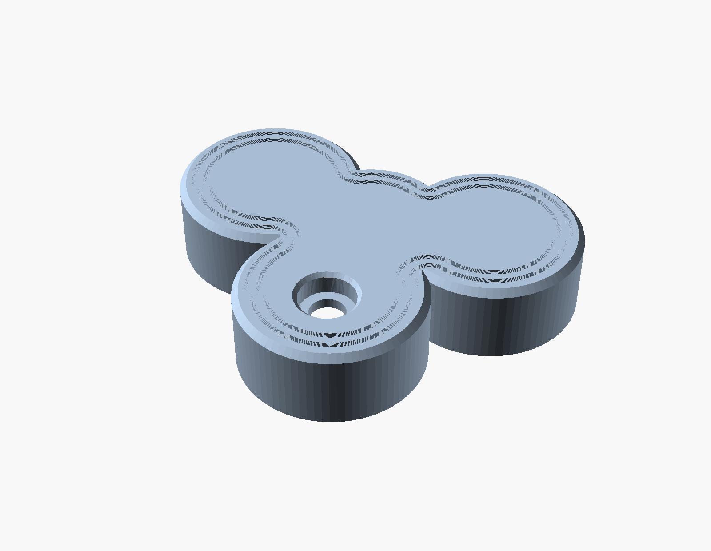

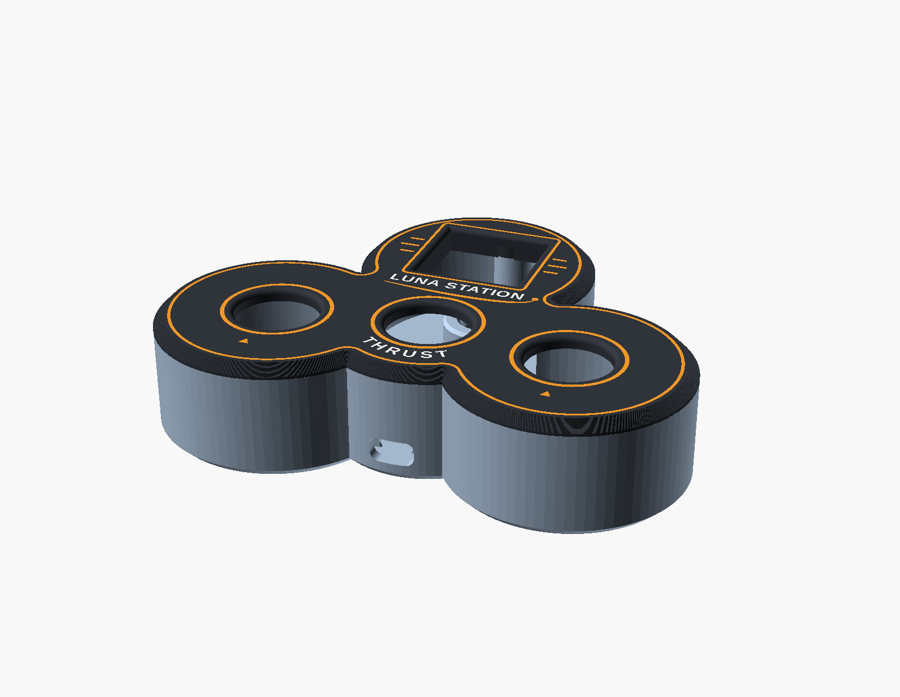

| Файл | Назначение |
|---|---|
| `v7/gamepad_case_v7.stl` | Корпус, Z 0–31 |
| `v7/gamepad_case_v7.scad` | Параметрический корпус (собирается из `v5/gamepad_case_v5_raw.stl` и модулей V4); `part` = `case`, `assembly`, `fit_check`, `plug_check`, `lid_check` |
| `v7/luna_station_v7.3mf` | Проект Bambu Studio: крышка V6 лицом вниз (3 цвета) и корпус V7 |
| `v7/make_3mf_v7.py` | Собирает `.3mf`, как `make_3mf_v6.py` |

Печать дном вниз: фаска и стенки канавок — свес 45°, дно канавки — мост
1 мм, поддержки не нужны. Bambu Studio (P1S, 0,20 мм): корпус ≈2 ч 10 мин,
71 г. Рендер в OpenSCAD ≈4,5 мин.

```sh
"$OPENSCAD" --export-format binstl -o v7/gamepad_case_v7.stl v7/gamepad_case_v7.scad
python3 v7/make_3mf_v7.py ПРОЕКТ.3mf --filaments 2,3,4
```

## Версия 6: классическая крышка с фаской и креплением матрицы

Корпус — `v5/gamepad_case_v5.stl` без изменений. Крышка собрана из основы V5
(окно 32×32, отверстия Ø24,6, магниты Ø10,1).

| Что | V5 | V6 |
|---|---|---|
| Верхний край крышки | скругление ≈1,6 мм | фаска 45°, 3 мм (`chamfer`) |
| Разметка | стрелки поворота и звёзды | классическая: контур, рамка окна с бороздками, кольца, «LUNA STATION» с орбитой, THRUST, треугольники ▲ под боковыми кнопками |
| Крепление LED-матрицы | нет | П-образная рамка-бленда 4 мм вокруг окна, 4 стойки Ø6,5×5 мм под вплавляемые гайки M2 (отверстие Ø3,2, глубина 5 мм), 3 круглых упора Ø4×5 мм |

Центры стоек — 40×24 мм вокруг центра окна (`boss_pitch`). Плата прижимается
к торцам стоек и упоров на 5 мм ниже крышки, светодиоды смотрят в окно.
Верхней стенки у рамки нет: там стоит магнитная стойка корпуса. Если отверстия
платы стоят иначе, поменяйте `boss_pitch` в SCAD и `BOSS_PITCH` в
`v6/prepare_lid_v6.py` — скрипт проверит, что стойки не задевают корпус
(зазор ≥0,6 мм).

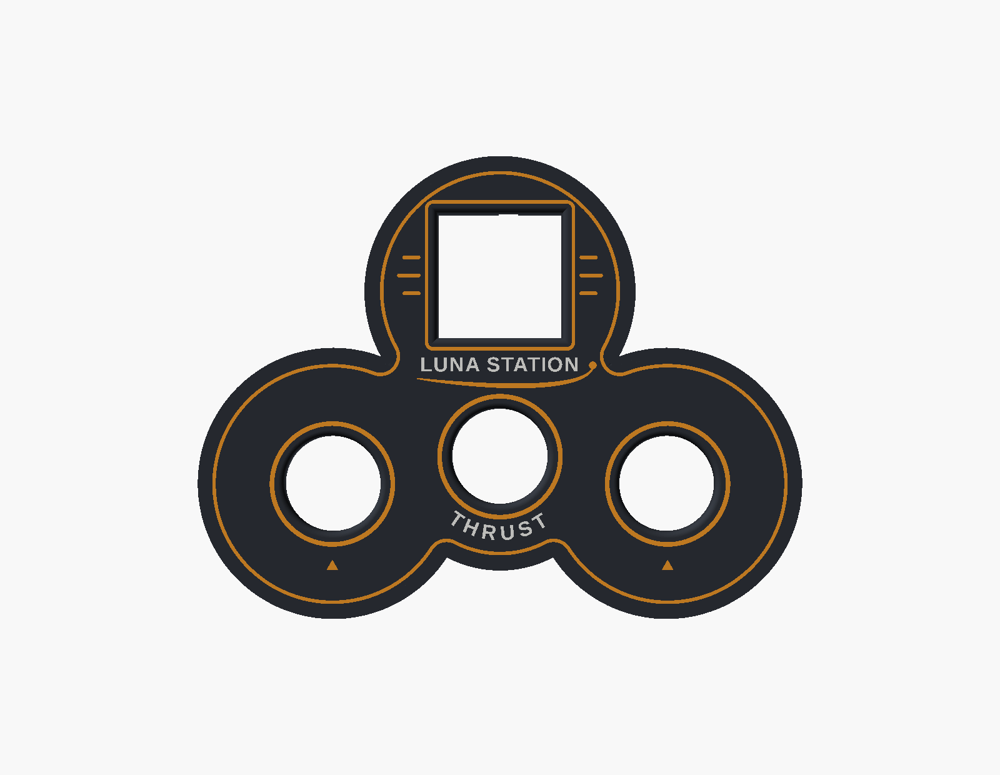

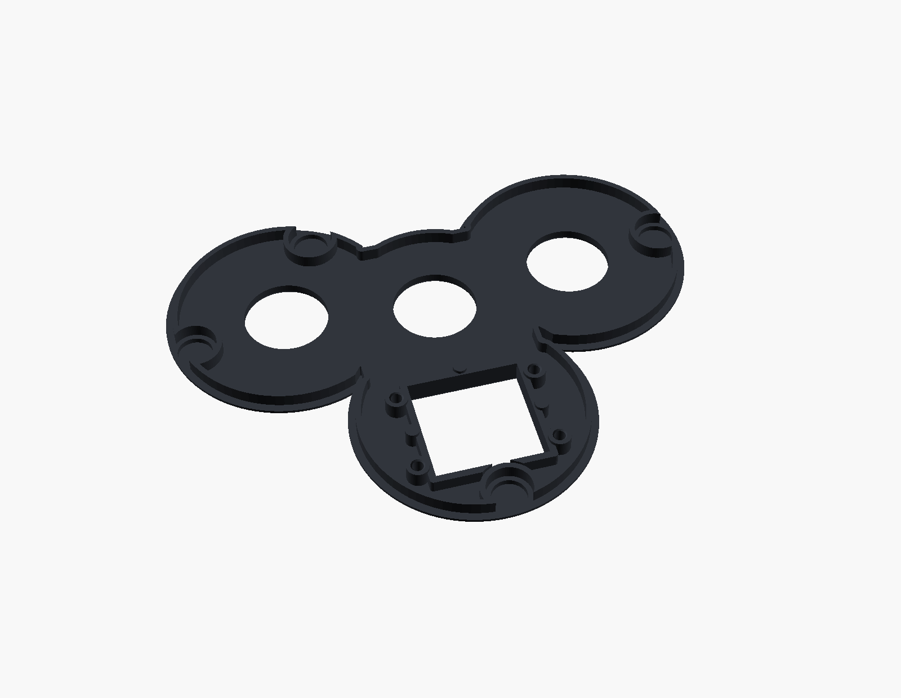

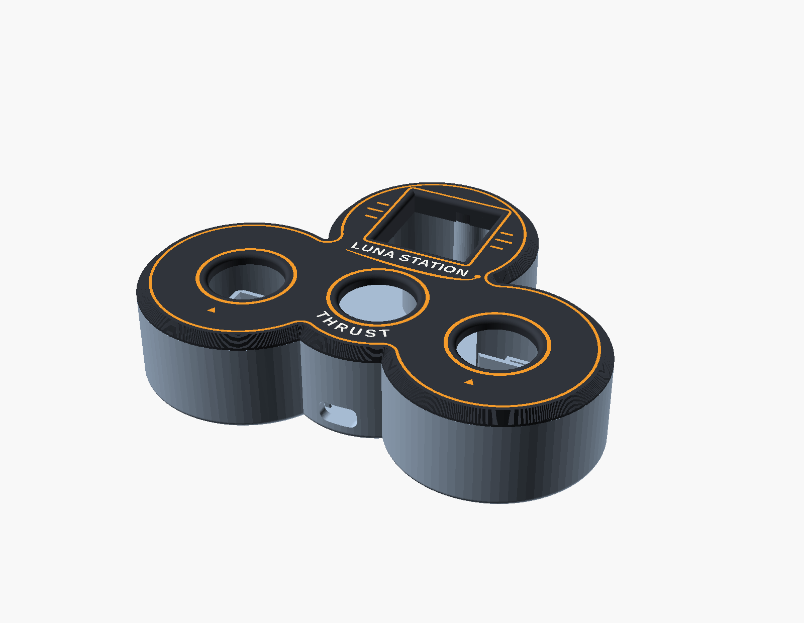

| Файл | Назначение |
|---|---|
| `v6/gamepad_lid_v6.stl` | Крышка: тело с фаской и креплением матрицы (тёмный цвет) |
| `v6/gamepad_lid_v6_text.stl` | Вставка: «LUNA STATION», THRUST (светлый цвет) |
| `v6/gamepad_lid_v6_accent.stl` | Вставка: контур, орбита, рамка, кольца, бороздки, треугольники (акцентный цвет) |
| `v6/gamepad_lid_v6.scad` | Параметрическая крышка; `part` = `body`, `text`, `accent`, `mount`, `preview` |
| `v6/prepare_lid_v6.py` | Создаёт `lid_v6_geometry.scad` (контур для фаски, рамка в свободной зоне) и проверяет стойки |
| `v6/luna_station_v6.3mf` | Проект Bambu Studio: крышка лицом вниз (3 цвета) и корпус V5 |
| `v6/make_3mf_v6.py` | Собирает `.3mf`, как `make_3mf_v5.py` |
| `v6/color_options/` | Эскизы цветов (чёрный, серый, оранжевый): `color_options_v6.png`, `variant_1…6.png`, `color_preview_v6.scad` |

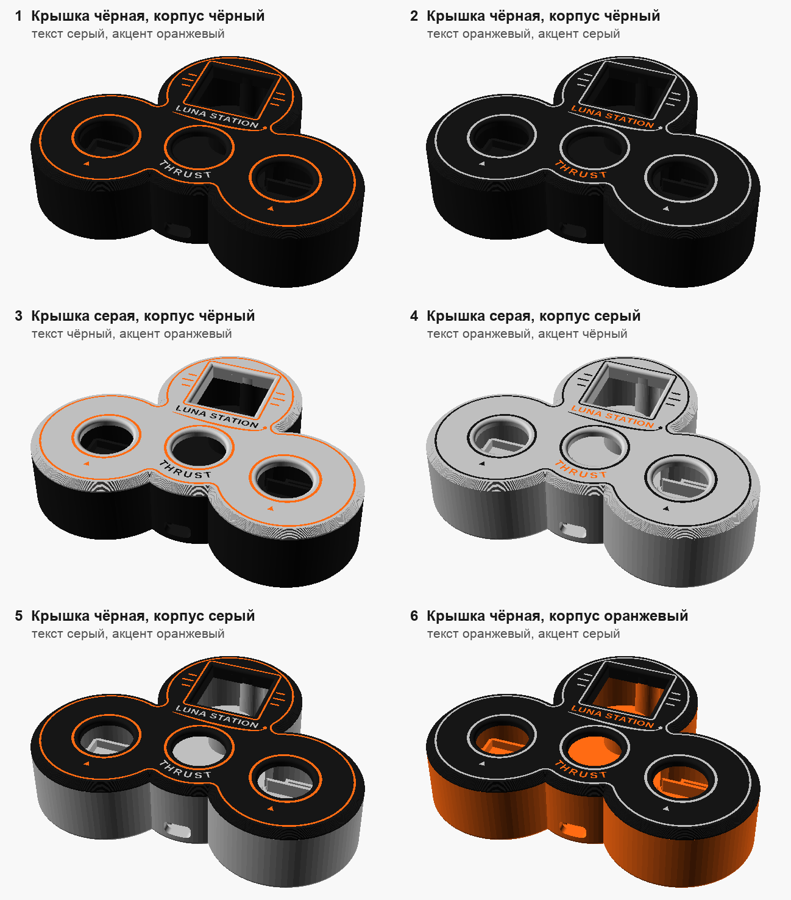

Цвета превью задаются в `v6/color_options/color_preview_v6.scad` (`cb`, `ct`, `ca`, `cc`).

Печать крышки лицом вниз: фаска у стола — свес 45°, стойки смотрят вверх,
поддержки не нужны. Bambu Studio (P1S, 0,20 мм): ≈1 ч 21 мин, 34 г.

```sh
python3 v6/prepare_lid_v6.py        # trimesh + shapely
for p in body text accent; do
  f=v6/gamepad_lid_v6_$p.stl; [ $p = body ] && f=v6/gamepad_lid_v6.stl
  "$OPENSCAD" --export-format binstl -o "$f" -D "part=\"$p\"" v6/gamepad_lid_v6.scad
done
python3 v6/make_3mf_v6.py ПРОЕКТ.3mf --filaments 2,3,4
```

## Версия 5: крышка «Luna station»

Расположение плат и внутренние карманы — как в V4. Изменения:

| Что | V4 | V5 |
|---|---|---|
| Окно LED-матрицы в крышке | 31×31 мм | 32×32 мм (+0,5 мм с каждой стороны) |
| Гнёзда магнитов (корпус и крышка) | Ø10,2 мм | Ø10,1 мм, глубина 1,7 мм без изменений |
| Ниша нижней кнопки | потолок на Z 5,5 | потолок на Z 7,5 (на 2 мм глубже); толщина перемычки и посадка кнопки сохранены, бобышка выше на 2 мм |
| Верх крышки | гладкий | инкрустация 0,6 мм: надпись, орбита, рамка окна, кольца кнопок, стрелки, звёзды |

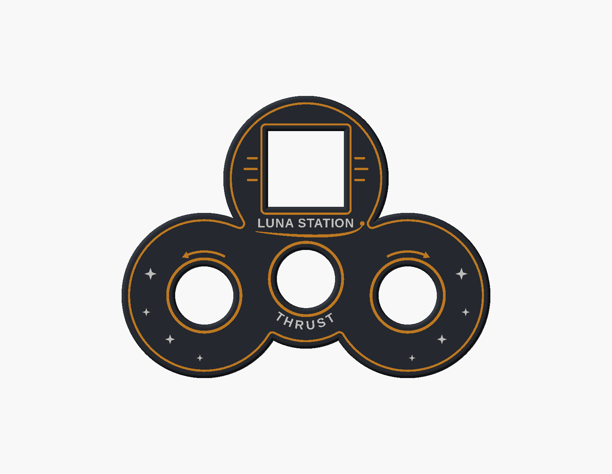

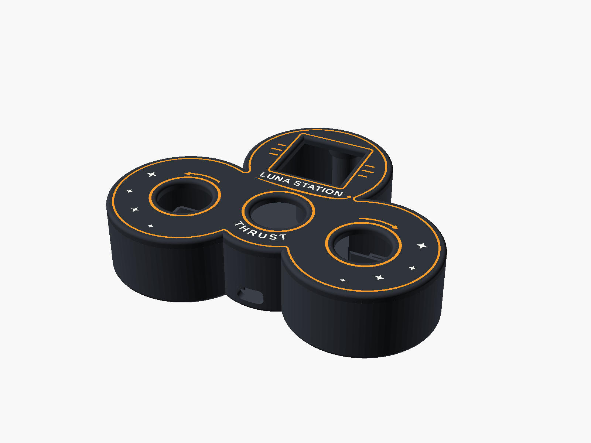

Кнопки, по прошивке (`buttonPins` = 27, 32, 25):

| Отверстие | Кнопка | Разметка |
|---|---|---|
| Левое | LEFT — поворот против часовой | стрелка против часовой |
| Среднее | THRUST — тяга | надпись THRUST по дуге |
| Правое | RIGHT — поворот по часовой | стрелка по часовой |

| Файл | Назначение |
|---|---|
| `v5/gamepad_case_v5.stl` | Корпус для печати |
| `v5/gamepad_lid_v5.stl` | Крышка: основное тело (тёмный цвет) с углублениями 0,6 мм |
| `v5/gamepad_lid_v5_text.stl` | Вставка: «LUNA STATION», THRUST, звёзды (светлый цвет) |
| `v5/gamepad_lid_v5_accent.stl` | Вставка: орбита, рамки, кольца, стрелки, контур (акцентный цвет) |
| `v5/gamepad_case_v5.scad` | Сборка корпуса; `part` = `case`, `lid`, `assembly`, `fit_check`, `plug_check`, `lid_check` |
| `v5/gamepad_lid_v5.scad` | Параметрическая разметка крышки; `part` = `body`, `text`, `accent`, `preview` |
| `v5/prepare_case_v5.py` | Магниты, ниша кнопки, окно; создаёт `gamepad_case_v5_raw.stl` и `gamepad_lid_v5_base.stl` |
| `v5/luna_station_v5.3mf` | Готовый проект Bambu Studio: крышка лицом вниз с назначенными цветами и корпус |
| `v5/luna_station_v5_face_up.3mf` | То же, крышка лицом вверх: смена цвета в последних трёх слоях |
| `v5/luna_station_v5_face_up_preview.png` | Превью Bambu Studio для варианта лицом вверх |
| `v5/make_3mf_v5.py` | Собирает оба проекта `.3mf` из STL и настроек существующего проекта Bambu |

### Многоцветная печать крышки

Три файла крышки находятся в общих координатах и не пересекаются. В Bambu
Studio / OrcaSlicer / PrusaSlicer импортируйте их одновременно и ответьте
«Да» на вопрос о загрузке как одного объекта из нескольких частей. Затем
назначьте филамент каждой части. Вставки занимают три слоя по 0,2 мм.

Рекомендуется печатать лицевой стороной вниз на текстурном PEI. Смена
цвета нужна только в первых трёх слоях, поэтому лицевая сторона получается
ровной и матовой. Минимальный зазор между элементами разметки — 0,65 мм.
Для одного цвета печатайте только `gamepad_lid_v5.stl`: разметка останется
неглубокой гравировкой.

### Готовый проект Bambu Studio

Оба проекта открываются в Bambu Studio с уже назначенными цветами:

| Пластина | Объект | Филамент |
|---|---|---|
| 1 | Крышка: тело | 2 — PLA #161616 (чёрный) |
| 1 | Вставка: «LUNA STATION», THRUST, звёзды | 3 — PLA #BCBCBC (светлый) |
| 1 | Вставка: орбита, рамки, кольца, стрелки, контур | 4 — PLA #F72323 (красный) |
| 2 | Корпус дном на столе | 2 — PLA #161616 |

Настройки: Bambu Lab P1S 0.4, «0.20mm Standard @BBL X1C», слой 0,2 мм,
заполнение 15 %, текстурный PEI. Корпус печатается без поддержек. Цвет
меняется щелчком по филаменту в списке. Соответствие слотам AMS
выбирается при отправке на принтер.

| Вариант | Файл | Смена цвета | Поддержки крышки | Крышка (CLI) |
|---|---|---|---|---|
| Лицом вниз | `v5/luna_station_v5.3mf` | слои Z 0,2–0,6 | нет | ≈77 мин, 33 г |
| Лицом вверх | `v5/luna_station_v5_face_up.3mf` | слои Z 7,2–7,8 | tree(auto) под пластиной, Z 0–3,8 | ≈139 мин, 47 г |

Лицом вниз лицевая сторона получается ровной и матовой от текстурного PEI.
Лицом вверх первый слой однотонный, а лицевая сторона — обычная верхняя
поверхность. Под крышкой есть фиксирующий бортик высотой 4 мм, поэтому
пластина крышки висит над столом. Поддержки стоят внутри бортика и по
внешнему свесу ≈2,2 мм. Их нижняя сторона скрыта в корпусе, но опорную
кромку на борту корпуса стоит зачистить. Блокировщики поддержек не пускают
их в гнёзда магнитов.

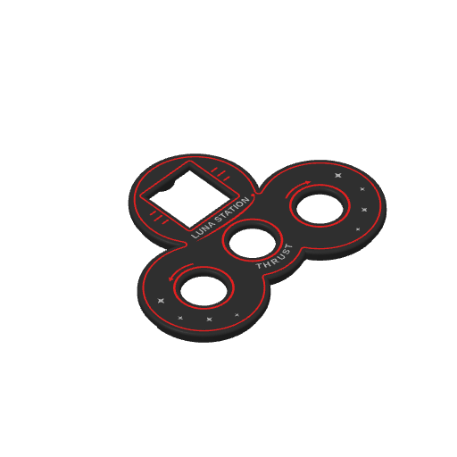

Проверка через Bambu Studio CLI: пластины нарезаются без предупреждений.
Корпус — около 114 мин и 66 г.

Принтер и филаменты берутся из любого своего проекта `.3mf`. Номера
филаментов для тела, светлой вставки и акцента:

```sh
python3 v5/make_3mf_v5.py ПРОЕКТ.3mf --filaments 2,3,4            # лицом вниз
python3 v5/make_3mf_v5.py ПРОЕКТ.3mf --filaments 2,3,4 --face up  # лицом вверх
```

Пересборка:

```sh
python3 v5/prepare_case_v5.py
OPENSCAD=/Applications/OpenSCAD.app/Contents/MacOS/OpenSCAD
"$OPENSCAD" --export-format binstl -o v5/gamepad_case_v5.stl v5/gamepad_case_v5.scad
for p in body text accent; do
  f=v5/gamepad_lid_v5_$p.stl; [ $p = body ] && f=v5/gamepad_lid_v5.stl
  "$OPENSCAD" --export-format binstl -o "$f" -D "part=\"$p\"" v5/gamepad_lid_v5.scad
done
```

## Версия 4: всё в одном корпусе высотой 30 мм

Основные файлы — **`v4/gamepad_case_v4.stl`** (корпус со встроенными
карманами) и **`v4/gamepad_lid_v4.stl`** (крышка). Исходники —
`v4/gamepad_case_v4.scad` и `v4/prepare_case_v4.py`.
Геометрия моделей V1–V3 не изменена.

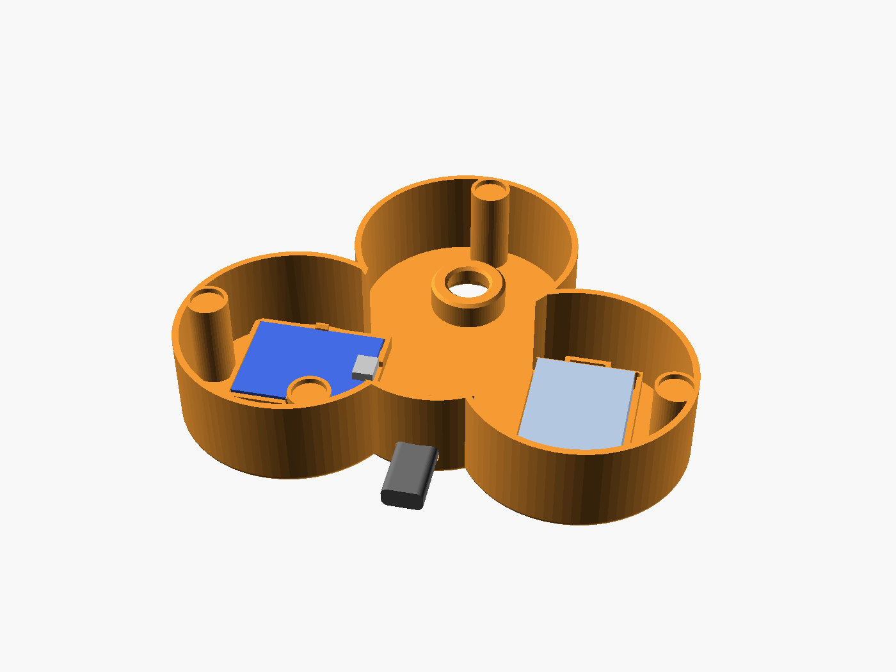

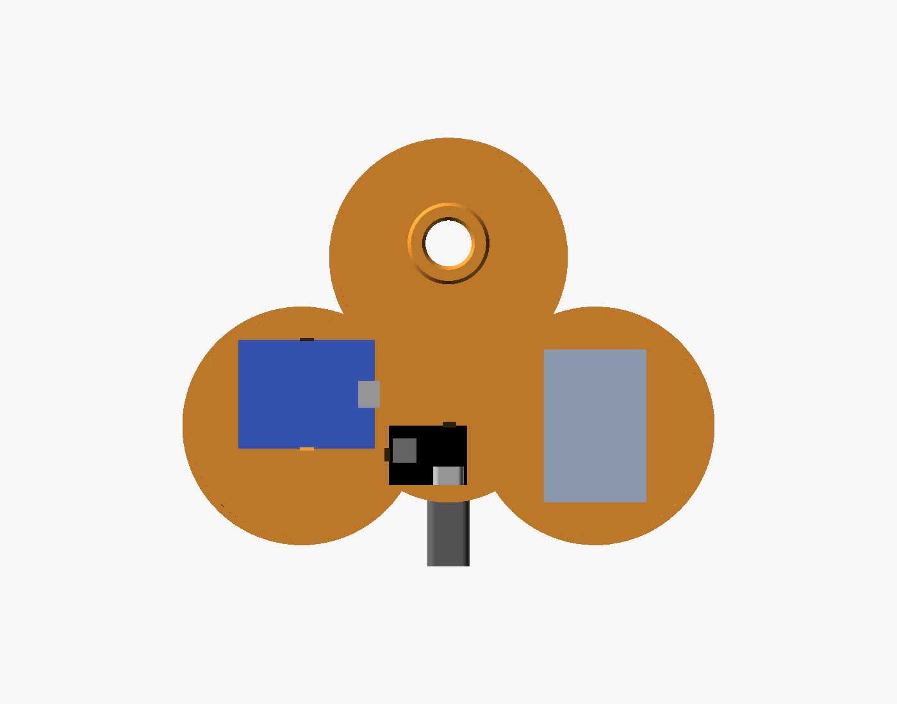

Раскладка повторяет фото `IMG_6791`. Отдельного нижнего отсека нет.

| Компонент | Место | Внутренний карман | Ориентация |
|---|---|---|---|
| ESP32 40×32 мм | левая рукоять, центр (−41,5; −15,5) | 41×33 мм (из V3) | Micro-USB к центру (+X), открытый вырез 12 мм |
| Зарядная плата | по центру у задней стенки | 25,4×19,75 мм (из V3) | USB-C наружу через заднюю стенку, центр X = 0, Z = 7,93 |
| Аккумулятор | правая рукоять, вертикально | 31,5×46,5 мм (из V2) | провод выходит у верха внутренней стенки; петли под липучку сверху и снизу |

Изменения корпуса:

- Высота **25,232 → 30,000 мм**. Подняты только верхний борт и верх стоек
  с гнёздами Ø10,2 мм (+4,768 мм). Дно 1,5 мм, стенки 2 мм и бобышка
  нижней кнопки сохранены.
- Все наружные нижние грани скруглены **R2** (в V1/V2 было R1), вход
  нижней кнопки — R1.
- Нижняя кнопка, все ступени +1 мм по диаметру: углубление
  Ø20,1 → 21,1 мм, отверстие Ø12,5 → 13,5 мм, верхняя фаска
  Ø14,5 → 15,5 мм. Стенка бобышки вокруг углубления — 1,4 мм.
- USB-C: паз 9,9×4,3 мм и наружная выборка 13×7,2 мм под корпус
  штекера в задней стенке между рукоятями. Зазор между карманом и изогнутой
  стенкой заполнен.

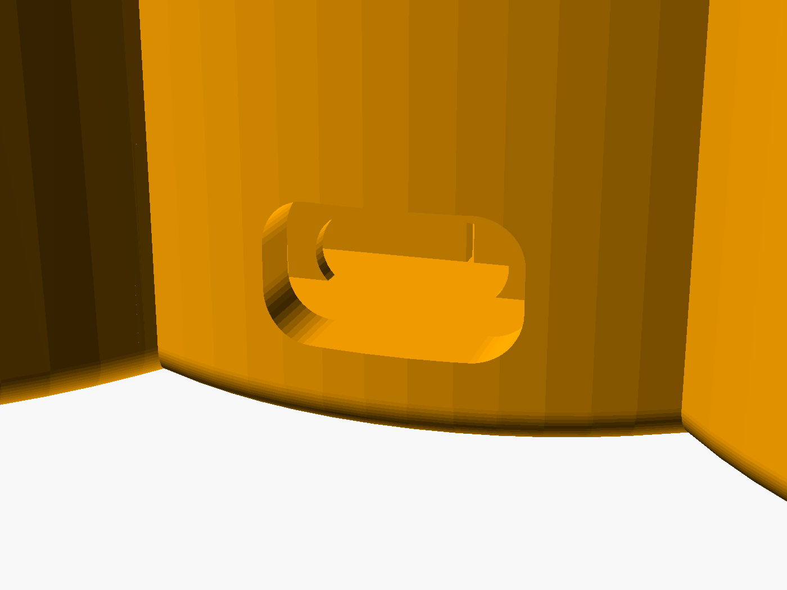

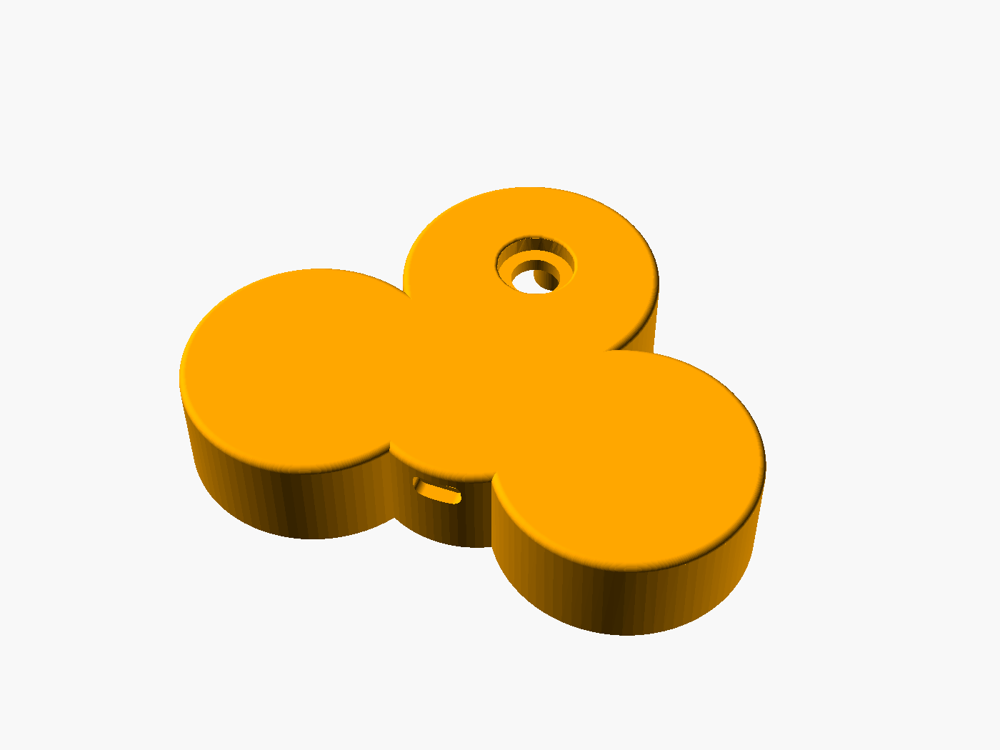

Крышка взята из `~/Downloads/Лунный Контроллер.stl` и сохранена как
`originals/gamepad_lid_original.stl`. В `v4/gamepad_lid_v4.stl` три круглых отверстия
кнопок увеличены с **Ø23,6 до Ø24,6 мм**, квадратное окно над нижней
кнопкой — с **30×30 до 31×31 мм** (по 0,5 мм на сторону); верхние
скругления сохранены. Остальная геометрия и координаты (Z 131–138,8) не
изменены.

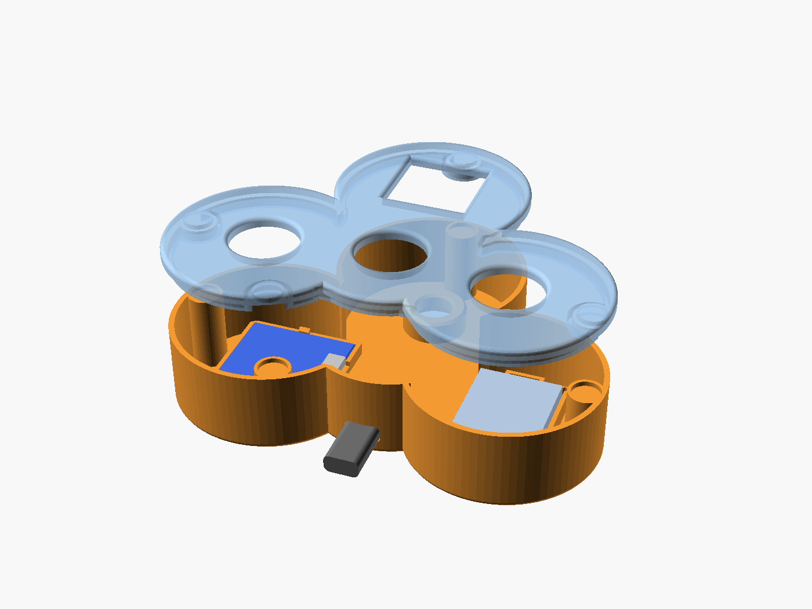

Низ пластины крышки лежит на борту при Z = 30. Верх компонентов:

- аккумулятор — ≈10,6 мм;
- платы с деталями — ≈10 мм;
- перемычка USB-C у задней стенки — 13 мм.

Под кнопками крышки остаётся **≈19 мм** по высоте. Глубину самих кнопок
проверить.

Проверено:

- одно замкнутое тело 156×119,5×30 мм;
- профиль R2 и все диаметры отверстий;
- размеры трёх карманов;
- нулевое пересечение с моделями плат, аккумулятора, штекера USB-C и с
  крышкой.

Прежние допущения V3 остаются:

- толщина ESP32 1,6 мм;
- положение Micro-USB приблизительное;
- крепление плат без монтажных отверстий.

Пересборка из этой папки:

```sh
python3 v4/prepare_case_v4.py   # Подготовленные STL и button_profile_v4.scad сохраняются в v4/
OPENSCAD=/Applications/OpenSCAD.app/Contents/MacOS/OpenSCAD
"$OPENSCAD" --export-format binstl -o v4/gamepad_case_v4.stl v4/gamepad_case_v4.scad
```

Варианты `part`:

- `assembly` — корпус с компонентами;
- `lid` — крышка на месте;
- `fit_check` / `plug_check` — пересечения, должны быть пустыми.

Печатать дном на столе, без поддержек. Сборка:

1. ESP32 завести краем к низу рукояти под неподвижный зацеп, затем прижать
   верхний край до защёлки.
2. Зарядную плату вставить USB-C в паз и прижать задний край.
3. Аккумулятор уложить проводами вверх и закрепить липучкой через петли.

## Версия 3: отдельный держатель для трёх компонентов

Основной файл — **`v3/gamepad_holder_v3.stl`**, исходник —
`v3/gamepad_holder_v3.scad`. Это изменение только центрального держателя;
корпус геймпада и модели V1/V2 не изменены.

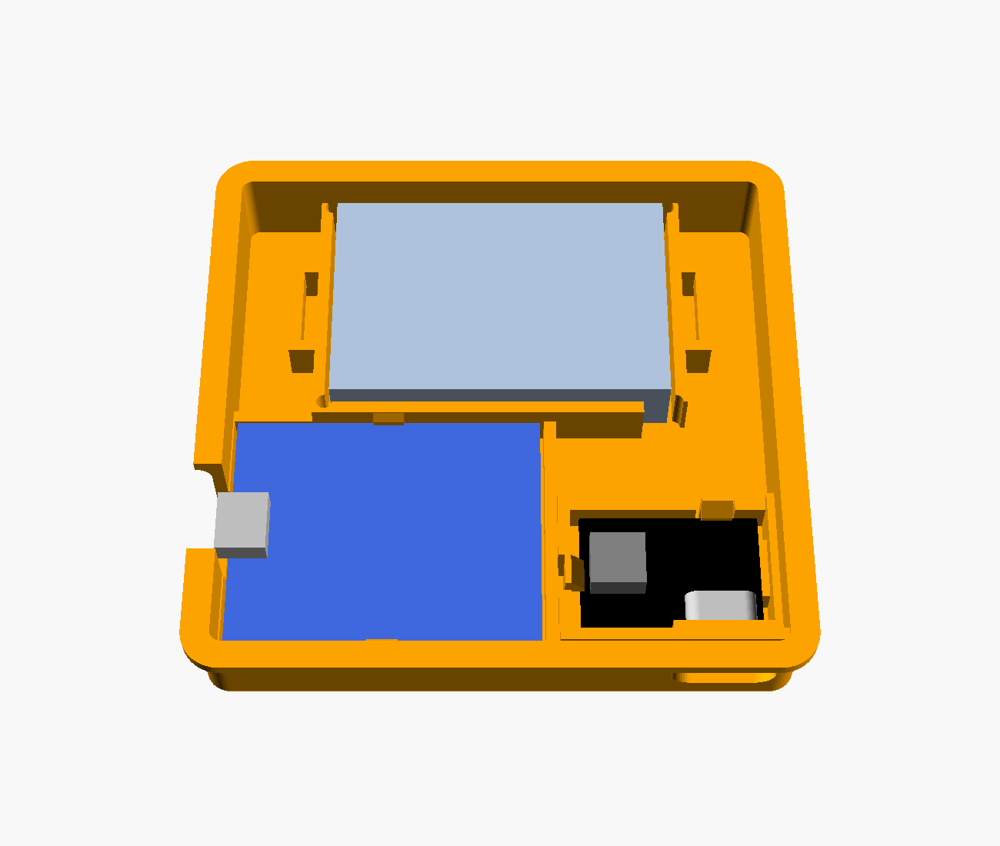

Сохранена центральная компоновка V2, но теперь все три компонента находятся
на одном уровне: поперечный аккумулятор сзади, зарядная плата и ESP32
рядом спереди. Синий прямоугольник — габаритная модель ESP32, а не модель
всех компонентов и паяных соединений конкретной платы.

| Отсек | Внутренний размер | Изменение |
|---|---|---|
| Аккумулятор | 46,5×31,5 мм | Геометрия кармана, петель и выхода провода из V2 сохранена |
| Зарядная плата | 25,4×19,75 мм | Было 23,4×17,75 мм; добавлен 1 мм с каждой из четырёх сторон |
| ESP32 | 41×33 мм | Под плату 40×32 мм, зазор 0,5 мм по периметру |

Батарейный отсек перемещён назад на 16 мм без изменения его размеров.
Внешний габарит держателя с верхним переходом — **78×76×13,6 мм**,
основной контур — 74×72 мм. Скругления наружных граней сохранены.
USB-C зарядной платы смотрит вперёд (+Y), его центр теперь X = −27,7 мм.
За зарядной платой оставлен участок для проводов и JST.

**V3 нельзя напрямую подставить в прежний корпус V2:** увеличились и
площадь основания, и требуемый проём; положение USB-C также изменилось.
Адаптация корпуса отложена. Эта модель предназначена сначала для примерки
самих компонентов, а не для печати готового геймпада в сборе.

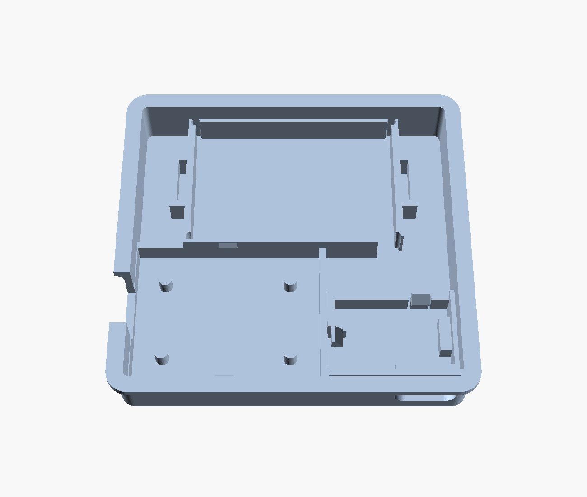

У ESP32 четыре опоры с просветом 3,5 мм под платой. Для установки завести
край со стороны аккумулятора под неподвижный задний зацеп, затем опустить
противоположный край до передней защёлки. Низкие бортики оставляют доступ
к пайке GPIO. С правого торца предусмотрен открытый вырез шириной 12 мм
для доступа к Micro-USB; его точная посадка не определялась по фотографии.
Для зарядной платы увеличен вылет фиксаторов, чтобы расширение кармана
не лишило её удержания. Верхняя перемычка USB-C находится выше текстолита.

Принята толщина ESP32 **1,6 мм** (`esp_thickness`). Перед печатью сверить
толщину и проверить, что нижние компоненты/пайка не попадают на опоры;
точные координаты монтажных отверстий не предполагались. Модель разъёма
ESP32 приблизительная. Для защёлок предпочтителен PETG; печатать плоским
дном на столе (STL сохраняет Z = −12 как в системе координат V2).

Пересборка из этой папки:

```sh
OPENSCAD=/Applications/OpenSCAD.app/Contents/MacOS/OpenSCAD
"$OPENSCAD" --export-format binstl -D 'part="holder"' -o v3/gamepad_holder_v3.stl v3/gamepad_holder_v3.scad
```

Для просмотра компонентов выбрать `part="assembly"`. Исходник использует
модули `v1/gamepad_power_holder.scad` и `v2/gamepad_case_v2.scad`.

## Версия 2: тонкие рукоятки и нижний центральный отсек

Основной файл — **`v2/gamepad_case_v2.stl`**. Геометрия версии 1 сохранена.

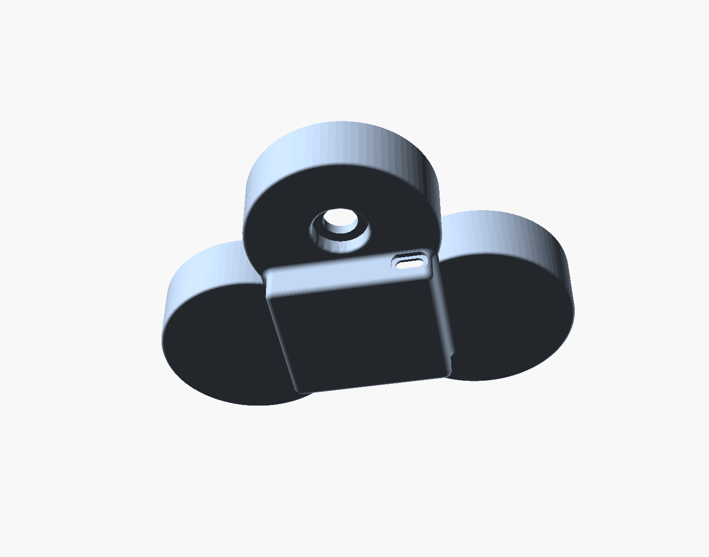

Рукоятки уменьшены по высоте ровно на 3 мм: с 25,232 до **22,232 мм**.
Толщина стенок, дна и глубина карманов крепления не масштабировались.
Верхняя кромка и карманы крепления опущены на 3 мм, посадка нижней кнопки
сохранена на прежней высоте.

Центральный отсек симметричен относительно X = 0 и выступает вниз на
согласованные **12 мм**. Полная высота в центре — **34,232 мм**.
Основной контур отсека 60×56 мм, с плавным переходом к корпусу — 64×60 мм.
Плоскость дна рукояток по-прежнему Z = 0, дно отсека — Z = −12 мм.
Аккумулятор развернут поперёк: 45 мм по X, 30 мм по Y; его верх — Z = −1,4 мм.

USB-C направлен вперёд, **к одиночному округлому выступу с нижней кнопкой**,
вдоль +Y. Разъём смещён влево от кнопки: центр X = −22, Z = −4,07 мм,
торец гнезда Y = 13,7 мм. Отсек и прямой штекер не перекрывают вертикальную
зону доступа диаметром 24 мм под кнопкой. Это относится к заложенному
штекеру шириной 12,4 и высотой 6,6 мм, не к любому угловому кабелю.

Скругления: наружный нижний край рукояток R1; входная кромка отверстия
нижней кнопки примерно R1; нижний край отсека и переход к дну корпуса R2;
вертикальные углы отсека R3. Внутренние ступени посадки кнопки не сглажены,
чтобы не менять её крепление. Защёлки платы и петли для ремешка находятся
внутри отсека; для провода батареи и прогиба задней защёлки оставлен вырез.

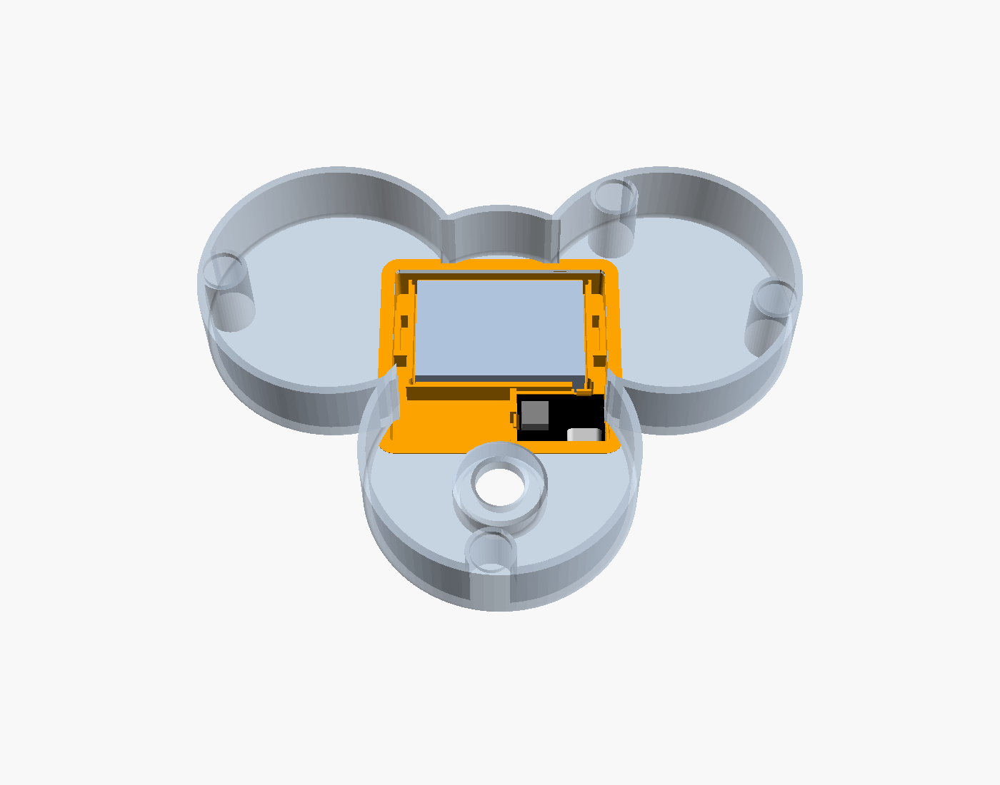

| Файл | Назначение |
|---|---|
| `v2/gamepad_case_v2.stl` | Цельный корпус V2 для слайсера |
| `v2/gamepad_case_v2_shell.stl` | Тонкая оболочка с проёмом под нижний отсек; не самостоятельный закрытый корпус |
| `v2/gamepad_case_v2_pod.stl` | Нижний отсек с держателями и USB-C; в координатах оболочки |
| `v2/gamepad_case_v2.scad` | Параметрическая сборка V2 |
| `v2/prepare_case_v2.py` | Подготовка укороченной оболочки и точного контура отверстия кнопки |
| `v2/gamepad_case_v2_thin_raw.stl`, `v2/button_profile_v2.scad` | Результаты подготовки, необходимые исходнику V2 |

Пересборка из этой папки (Python 3 без дополнительных пакетов и OpenSCAD):

```sh
python3 v2/prepare_case_v2.py
OPENSCAD=/Applications/OpenSCAD.app/Contents/MacOS/OpenSCAD
"$OPENSCAD" --export-format binstl -D 'part="shell"' -o v2/gamepad_case_v2_shell.stl v2/gamepad_case_v2.scad
"$OPENSCAD" --export-format binstl -D 'part="pod"' -o v2/gamepad_case_v2_pod.stl v2/gamepad_case_v2.scad
"$OPENSCAD" --export-format binstl -D 'part="case"' -o v2/gamepad_case_v2.stl v2/gamepad_case_v2.scad
```

`part="assembly"` показывает компоновку; `pod_drop` задаёт глубину отсека
(не менее 12 мм с нынешними опорами платы и габаритами штекера).
В отличие от V1, при печати цельной модели нижним отсеком на столе
**нужны поддержки под нависающим дном рукояток**. Перед печатью проверить
опоры в слайсере; PETG предпочтителен для защёлок.

В проекте пока нет геометрии крышки, ESP32, кнопки в сборе и остальной
электроники. Их совместимость и удобство хвата требуют примерки.
Размеры платы питания и аккумулятора по-прежнему основаны на фото.

## Версия 1 для корпуса Group (Z+)

Исходный корпус сохранён без изменений в `originals/gamepad_case_original.stl`.
Его габариты — 156,0×119,5×25,232 мм, дно примерно 1,5 мм, стенки примерно
2 мм. Все файлы ниже сохраняют исходные оси корпуса и размеры в миллиметрах.

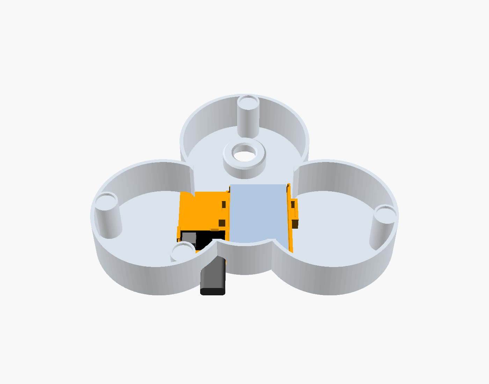

| Файл | Назначение |
|---|---|
| `v1/gamepad_case_with_holder.stl` | Объединённый корпус с держателем, вырезом USB-C и нижним скруглением R1 |
| `v1/gamepad_case_rounded.stl` | Только корпус со скруглением R1, без держателя и без нового отверстия USB-C |
| `v1/gamepad_holder_positioned.stl` | Держатель, уже перенесённый в систему координат корпуса |
| `v1/usb_c_cutter_positioned.stl` | Соответствующий вырез с запасом длины для криволинейной стенки |
| `v1/gamepad_case.scad` | Параметры скругления, положения и объединения |

Держатель расположен в нижней центральной части: если смотреть внутрь
корпуса, центральное круглое отверстие находится сверху, плата питания —
слева внизу, аккумулятор — справа от неё. Отсек за платой остаётся под
провода и JST. USB-C выходит между рукоятками, левее середины.

Перенос универсального держателя: **X = −35,0; Y = −41,7; Z = 1,48 мм**,
без поворота (`holder_position`, `holder_rotation`). Основание заглублено
в дно примерно на 0,02 мм для надёжного булева объединения. Центр USB-C:
X = −15,7; Z = 9,41 мм; торец гнезда находится при Y = −43,4 мм.
В криволинейной стенке предусмотрена выборка под корпус штекера 13×7,2 мм;
она глубже с одной стороны, поэтому гнездо не заподлицо со всей стенкой.

Верх аккумулятора находится при Z = 12,08 мм: до края корпуса остаётся
примерно 13,15 мм. Самая высокая часть держателя — Z = 14,51 мм.
Стойки крепления, центральное отверстие и верхняя кромка сохранены.
Основание держателя не скруглялось: скруглён только **наружный нижний край
корпуса**, радиус 1 мм. Плоская опорная поверхность осталась при Z = 0.

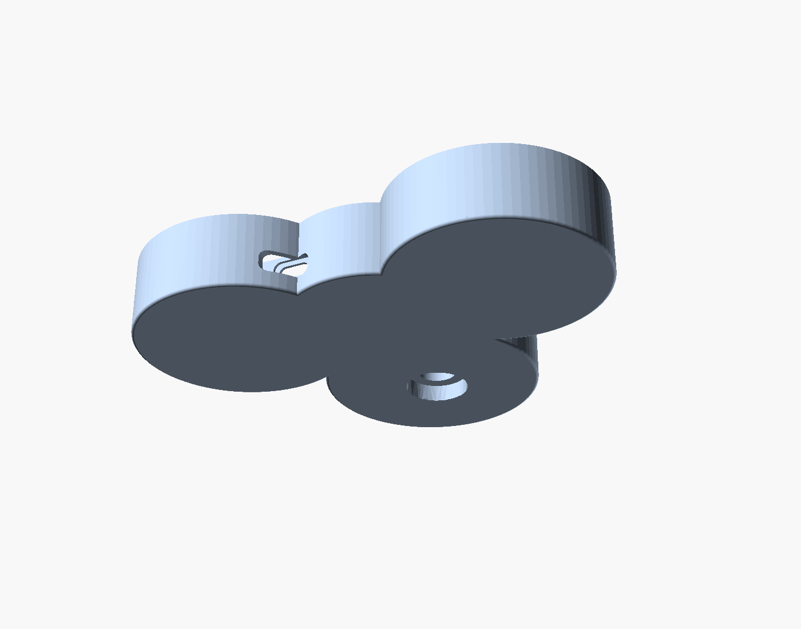

Для печати цельного варианта достаточно `v1/gamepad_case_with_holder.stl`,
плоским дном на стол. При ручном объединении отдельных частей использовать
`v1/gamepad_case_rounded.stl`, `v1/gamepad_holder_positioned.stl` и
`v1/usb_c_cutter_positioned.stl`, **не центрируя их по отдельности**.

Пересборка из этой папки:

```sh
OPENSCAD=/Applications/OpenSCAD.app/Contents/MacOS/OpenSCAD
"$OPENSCAD" --export-format binstl -D 'part="case"' -o v1/gamepad_case_with_holder.stl v1/gamepad_case.scad
"$OPENSCAD" --export-format binstl -D 'part="rounded"' -o v1/gamepad_case_rounded.stl v1/gamepad_case.scad
"$OPENSCAD" --export-format binstl -D 'part="holder"' -o v1/gamepad_holder_positioned.stl v1/gamepad_case.scad
"$OPENSCAD" --export-format binstl -D 'part="cutter"' -o v1/usb_c_cutter_positioned.stl v1/gamepad_case.scad
```

`part="assembly"` показывает плату, аккумулятор и условный штекер;
`fit_check` и `plug_check` выводят пересечения компонентов и штекера с
корпусом. Скругление задаётся `bottom_radius`; 0 отключает его, для этого
тонкого дна разрешено не более 1,2 мм.

Это вариант компоновки по предоставленному STL и габаритным моделям
компонентов. Крышка, ESP32, кнопки и их внутренние крепления не представлены:
их совместимость пока неизвестна. Размеры платы и аккумулятора по-прежнему
нужно сверить с реальными деталями; у конкретного кабеля корпус штекера
может оказаться шире заложенной выборки.

## Объединение универсального держателя с другим корпусом

Оба STL в одной системе координат:

- Y = 0 — внутренняя поверхность стенки корпуса с USB-C, +Y внутрь корпуса,
  наружная поверхность при Y = −2,0 (`case_wall`);
- Z = 0 — внутренняя поверхность дна корпуса;
- X = 0 — левый край держателя. Центр USB-C: X = 19,3, Z = 7,93.

Совместить держатель с дном и стенкой, затем выполнить
`difference(union(корпус, держатель), usb_c_case_cutter)`. Вырез даёт паз
9,9×4,3 мм для разъёма и выборку 13,0×7,2×1,0 мм снаружи под корпус штекера.
Передняя стенка держателя повторяет стенку корпуса; при другой толщине
стенки изменить `case_wall` и пересобрать оба STL. Для изогнутой стенки
можно задать `include_front_wall = false`.

## Перед печатью

Размеры платы сняты по фото — проверить штангенциркулем `pcb_w`, `pcb_d`,
`pcb_t`, `usb_cx` (центр разъёма от левого края платы, разъём к себе) и
`usb_overhang`. Разъём считается установленным на верх платы; для
утопленного разъёма задать `usb_z_off`.

```sh
OPENSCAD=/Applications/OpenSCAD.app/Contents/MacOS/OpenSCAD
$OPENSCAD -D 'part="holder"' -o v1/gamepad_power_holder.stl v1/gamepad_power_holder.scad
$OPENSCAD -D 'part="cutter"' -o v1/usb_c_case_cutter.stl v1/gamepad_power_holder.scad
$OPENSCAD -D 'part="interference"' -o /tmp/interference.stl v1/gamepad_power_holder.scad
```

Проверка `interference` должна давать нулевой объём (только касания опор).
Печать без поддержек, слой 0,2 мм; для защёлок лучше PETG.

## Сборка

1. Припаять провода к контактам на верхней стороне платы.
2. Вставить плату наклонно: USB-C в паз, затем прижать задний край до
   щелчка двух защёлок. Провода уходят над задней стенкой в отсек за платой.
3. Аккумулятор уложить проводами назад; провода выходят через вырез
   перегородки в тот же отсек, где помещается разъём JST.
4. Закрепить аккумулятор липучкой до 10 мм через две петли и/или
   двусторонней вспененной лентой.
