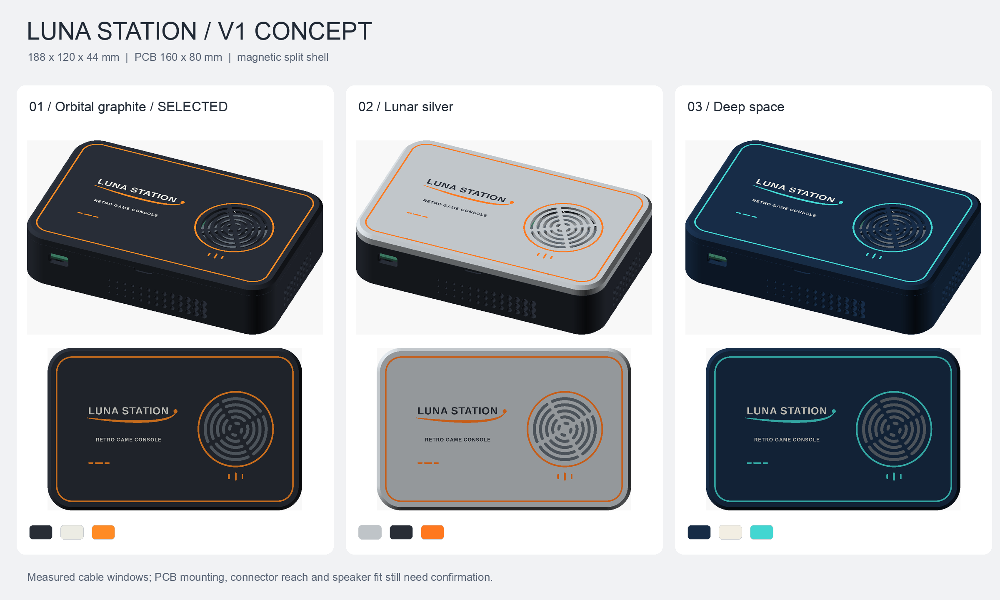
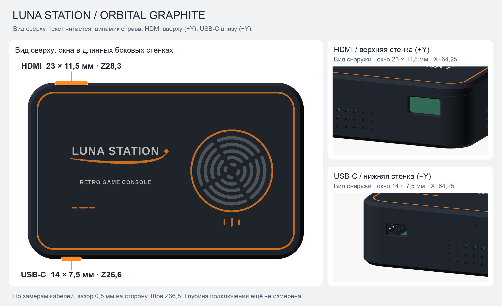
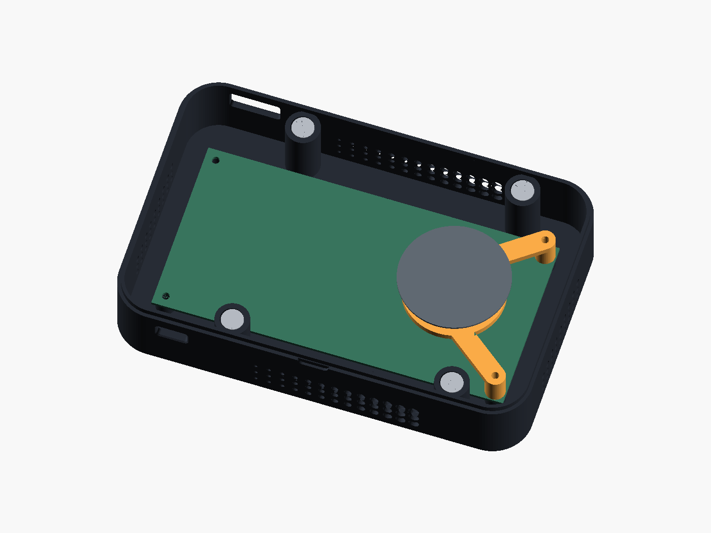

# Luna Station — корпус консоли, концепт V1

**Это параметрический концепт, а не модель с подтверждённой посадкой реальной
электроники.** Пользователь выбрал сначала форму и расцветки, затем замеры.
Подтверждены плата 160×80 мм, крепёж M3, магниты половин Ø10×1,5 мм
и диаметр магнита динамика 32 мм. Выбран **Orbital graphite**. Окна
HDMI и USB-C привязаны к замеренным штекерам и координатам осей над платой.
Высота установки и толщина платы, положение её отверстий, глубина подключения
кабелей и геометрия динамика ниже остаются предварительными.



## Оформление и варианты цвета

За основу взята крышка геймпада V6: тот же шрифт и оригинальная орбита из
`hardware/gamepad-power-holder/v6/gamepad_lid_v6.scad`, контурная линия,
короткие штрихи и фаски. Логотип не перерисован: SCAD использует исходный
модуль `orbit()`. Прямоугольная форма адаптирована к большой плате консоли,
а не повторяет рукоятки геймпада.

| Вариант | Нижняя часть | Крышка | Надписи | Орбита, контур и кольцо |
|---|---|---|---|---|
| 1 — Orbital graphite | Графит | Графит | Тёплый белый | Оранжевый |
| 2 — Lunar silver | Графит | Светло-серый | Графит | Оранжевый |
| 3 — Deep space | Тёмно-синий | Тёмно-синий | Молочный белый | Бирюзовый |

Каждому варианту достаточно трёх цветов. **Вариант 1 выбран пользователем**;
варианты 2 и 3 сохранены для сравнения. Вариант 1 наиболее близок к
существующим геймпадам; вариант 2 сильнее подчёркивает разъём половин.
Визуализация не моделирует блеск и фактический цвет конкретного филамента.

## Геометрия

Все размеры в миллиметрах. XY = центр платы, X вдоль стороны 160 мм,
Z = высота от внешней нижней плоскости корпуса.

| Элемент | V1 |
|---|---|
| Габариты собранного корпуса | 188×120×44 |
| Углы в плане | R18 |
| Верхняя и нижняя наружные кромки | Фаска 45°, 2,4 |
| Стенки / дно / крыша | 3,2 / 3,2 / 3,2 |
| Разъём половин | Низ до Z36,5; верх начинается на Z36,65; общая высота не изменена |
| Центрирующий бортик | Высота 3; толщина 1,6; боковой зазор 0,3 на сторону |
| Полость паза крышки | Осевой зазор над бортиком 0,45 |
| Плата | 160×80×1,6; нижняя поверхность Z10 |
| Угловые отверстия платы | Отступ 5 от каждого края, шаг 150×70, Ø3,4 — предварительно |
| Стойки платы | Ø9,2, от дна Z3,2 до Z10 |
| Гнёзда M3 heat-set inserts | Ø4,2, глубина 5,4, заходная фаска 0,3 — предварительно |
| Магнитные соединения | 4 пары / 8 магнитов Ø10×1,5 |
| Центры магнитов | X = −40 и +60, Y = ±49,5; вне контура платы и путей кабелей |
| Гнёзда магнитов | Ø10,3×1,7, открыты к разъёму; заходная фаска 0,25 |
| Цветные вставки | Заподлицо, глубина 0,6; 3 слоя по 0,2 |
| Прорези решётки | 5 рядов дуг, ширина 2,2, округлённые окончания |
| Перемычки решётки | Между рядами 2,3; четыре радиальных ребра не уже примерно 2,4 |

Бортик воспринимает боковой сдвиг: магниты не используются как
направляющие. Паз не является герметичным уплотнением. У переднего шва есть
неглубокая выемка для поддевания крышки. На дне — две контурные канавки
глубиной 0,6, как у геймпада V7.

**M3 — обозначение резьбы, не наружного диаметра вплавляемой втулки.**
Параметры `insert_bore` и `insert_depth` нужно согласовать с конкретной
втулкой и рекомендациями производителя. Перед полной печатью следует
проверить посадку на небольшом образце из выбранного материала.

Магниты вклеиваются. При посадке до дна карманов их торцы утоплены на 0,2;
расстояние между встречными торцами составит 0,55 с учётом зазора половин.
Сила удержания зависит от марки магнитов и фактического клеевого шва,
физически пока не проверена. Полярность каждой пары проверяется до вклейки.

## Боковые окна HDMI и USB-C



**Стороны определяются по виду сверху, когда текст на крышке читается
(динамик справа):** HDMI находится на верхней длинной боковине (Y+),
USB-C — на нижней (Y−). Это не два окна на одном торце. Оба окна смещены
к половине без динамика, X < 0. Если смотреть от короткого торца без динамика
(X−) в сторону динамика (X+), корпус дном вниз, HDMI окажется слева,
USB-C справа.

| Окно | Центр X / Y / Z | Проходное сечение | Радиус углов |
|---|---|---|---|
| HDMI, верхняя боковина (Y+) | −64,25 / +60 / 28,3 | 23×11,5 | 1,5 |
| USB-C, нижняя боковина (Y−) | −64,25 / −60 / 26,6 | 14×7,5 | 1,5 |

Размеры даны в мм. Исходные замеры пользователя:

| Замер | HDMI | USB-C |
|---|---|---|
| Пластиковый корпус штекера, ширина × высота | 22×10,5 | 13×6,5 |
| Ось разъёма над верхней поверхностью основной платы | 16,7 | 15 |
| Отступ оси от короткого края платы без динамика | 15,75 | 15,75 |

К ширине и высоте штекера добавлено **по 0,5 мм на сторону**.
Округления R1,5 не обрезают даже прямоугольный габарит замеренного штекера.
Снаружи у обоих окон фаска 0,6. Это проходные окна, не крепления панельных
гнёзд. Их оси привязаны к основной плате 160×80 мм, а не к отдельному модулю
Tang. Абсолютные высоты Z рассчитаны при нижней поверхности платы Z10
и толщине 1,6; при уточнении этих параметров окна автоматически смещаются.

По согласованию с пользователем шов поднят до **Z36,5** при сохранении
габарита 188×120×44. Вырезы целиком в нижней половине. Над наружным проёмом
HDMI до шва остаётся 1,85 мм пластика, над USB-C — 5,55 мм.
Бортик не разрезан; над его пазом в крышке остаётся 0,85 мм до внутренней
поверхности крыши. Две магнитные пары со стороны разъёмов перенесены
с X−60 на X−40 в обеих половинах, остальные остаются на X+60.
Стойки M3 и мостик динамика не изменены.

Между внутренней поверхностью длинной стенки и кромкой платы **16,8 мм**.
Полное сечение каждого окна свободно до этой кромки в CAD-сборке, но это
ещё не подтверждает полное подключение реального штекера. Нужны расстояние
от торца гнезда до стенки и проверка, что утолщение или изгиб кабеля не мешают
вставить штекер до конца. При необходимости выбираются удлинители или
панельные разъёмы; их крепления пока не предусмотрены.
Замеры в SCAD: `hdmi_plug`, `hdmi_axis_above_pcb`, `hdmi_from_edge`
и соответствующие `usb_c_*`. Параметры `hdmi_x`, `hdmi_z`, `hdmi_window`
и соответствующие `usb_c_*` вычисляются из них; общий зазор — `port_clearance`,
фаска — `port_bevel`, радиусы — `hdmi_r` и `usb_c_r`.

## Мостик динамика



Отдельная деталь с кольцом и двумя ножками опирается на плату в двух правых
угловых отверстиях **X75, Y±35**. Длинные M3 проходят через ножки и плату
в те же вплавляемые втулки нижнего корпуса. Дополнительные отверстия в плате
для мостика не предполагаются. Две левые точки крепления платы независимы.

| Элемент | Предварительная геометрия |
|---|---|
| Центр динамика | X45, Y0 |
| Наружный диаметр кольца | 46 |
| Отверстие под магнит Ø32 | Ø32,4, то есть 0,2 радиального зазора |
| Толщина кольца и плеч | 3,2 |
| Низ / верх кольца | Z22,2 / Z25,4 |
| Высота ножек над платой | 10,6 до низа плеч |
| Отверстия крепления | Ø3,4, сквозные через ножки |
| Прорези под узкие стяжки | 4 прорези 1,8×4 |
| Условный динамик | Корзина Ø50; магнит высотой 8 ниже опорной плоскости; фронт на 11 выше |
| Зазор от магнита до голой платы | 5,8 |
| Зазор от фронта до внутренней стороны крышки | 4,4 |

**Ни отверстие, ни магнит динамика сами по себе не удерживают динамик от
выпадения.** Кольцо должно поддерживать жёсткий задний уступ корзины.
Прорези предусмотрены для дополнительной фиксации за жёсткие части корзины,
не за диффузор, подвес или провода. Пригодность такого крепления зависит
от реального динамика: после замеров может потребоваться отдельный прижим
или крепление за штатные ушки. Текущая модель динамика — только габарит,
не изображение реального изделия.

В предварительной геометрии M3×20 через мостик входит на 4,6 ниже
поверхности стойки; M3×6 через одну плату — на 4,4. Это ориентиры, не
окончательная спецификация болтов: учесть длину втулок, шайбы и форму головок.
На плате вокруг отверстий нужны свободные от компонентов и проводников зоны
под ножки Ø9,2. Усилие затяжки не должно изгибать плату.

Под динамиком нужны свободные от высоких компонентов места. Параметр
`component_h = 17` — лишь записанное допущение для остальной платы;
это **не** проверенная высота реальной электроники и не разрешённая высота
под динамиком. Оси разъёмов привязаны к замерам основной платы,
но глубина подключения кабелей и прокладка проводов ещё не определены.

## Тест посадки

`luna_station_fit_test.3mf` — тонкий одноцветный образец, который печатается
**до корпуса** (сетка `stl/fit_test.stl`, лист `previews/fit_test.png`).
Он не моделируется заново: из `bottom()` вырезаются только места, которые
определяют посадку, и ставятся на каркас толщиной 1,6 мм. Нижние 1,6 мм дна
срезаны, поэтому всё опущено ровно на 1,6 мм, а взаимное положение стоек,
платы и окон такое же, как в корпусе.

- 4 стойки с гнёздами Ø4,2 под вставки M3; верх стоек — на уровне низа платы.
- Стенки с окнами HDMI (+Y) и USB-C (−Y) на полную высоту до шва, с рёбрами
  жёсткости ниже трассы кабелей.
- Кольцо Ø32,4 — отверстие мостика под магнит динамика.
- Планка подбора: гнёзда магнитов Ø10,1 / 10,3 / 10,5 глубиной 1,7 мм и гнёзда
  вставок Ø4,0 / 4,2 / 4,4; размеры выдавлены рядом.

Печатать тем же пластиком, соплом и профилем, что и корпус, дном на стол.
Габарит 198×120×34,9 мм, объём сетки около 27 см³. На P1S образец стоит
в X29…227 / Y68…188 и не задевает запретную зону; башня не нужна.
Мосты над окнами такие же, как у корпуса.

Порядок проверки:

1. Вставить магнит 10×1,5 в гнёзда планки и выбрать посадку; вплавить вставки
   M3 в три гнезда планки и выбрать диаметр.
2. Вплавить вставки в 4 стойки, положить плату, вкрутить 4 винта M3 —
   без перекоса и усилия.
3. Вставить HDMI и USB-C через окна в разъёмы платы — штекер входит прямо,
   с равным зазором.
4. Убедиться, что магнит динамика проходит в кольцо Ø32,4.

Если что-то не совпадает, нужно смещение в мм и направление (к динамику
или от него, к HDMI или к USB-C, вверх или вниз). Правятся `hole_inset`,
`board_z`, `port_measurements`, `insert_bore`, `magnet_clearance`,
`speaker_bore_clearance`, затем пересобираются корпус и образец.

## Дно «Кратеры»

После удачного теста посадки низ получил оформление (вариант 3 из
`previews/base_options.png`, параметр `base_style = 3`; 1 — «Эквалайзер»,
2 — «Lander», 0 — без вырезов). Крышка, габариты, стойки, магниты и окна
HDMI/USB-C не менялись; тест посадки строится из низа без оформления.

- По бокам: три ряда круглых отверстий, на длинных стенках диаметр растёт
  от 1,6 до 4,8 мм к динамику, на торцах — Ø3,2. Отверстия стоят только между
  магнитными стойками (X −26…46) и ниже окон кабелей (Z 9…20).
- Дно: полутоновая «луна» Ø62 под динамиком, точки Ø1,6…5,4 мм,
  около 27 % открытой площади, в оранжевом кольце, как решётка крышки.
- Цвета на нижней грани, 0,6 мм (3 слоя): белые `LUNA STATION`,
  `RETRO GAME CONSOLE` (как на крышке), `2026` и `retro@lea.lt`;
  оранжевые орбита, кольцо и два контура.
  Надпись зеркальная в модели и читается, когда корпус перевёрнут через
  длинную сторону. В Lunar silver надпись берёт серебристый цвет крышки.
- 4 выемки Ø13 × 1,2 мм под самоклеящиеся ножки 12,7 мм в (±73, ±39).
  Для других ножек поменять `foot_d`, `foot_depth`.

Всё печатается без поддержек: отверстия в стенках не больше Ø5,4.
Лист: `previews/base.png`.

## Файлы и печать

| Файл | Назначение |
|---|---|
| `luna_station.scad` | Параметрический исходник всех деталей и сборки |
| `stl/bottom.stl` | Нижняя половина со стойками, бортиком, отверстиями и выемками под ножки |
| `stl/base_text.stl`, `stl/base_accent.stl` | Цвета дна: надписи; орбита, кольцо, контуры |
| `stl/lid.stl` | Верхняя половина с решёткой и углублениями под цвета |
| `stl/text.stl` | Цветная вставка: LUNA STATION и RETRO GAME CONSOLE |
| `stl/accent.stl` | Вставка: орбита, контур, кольцо, штрихи |
| `stl/bridge.stl` | Мостик динамика |
| `luna_station_1_lid.3mf` … `luna_station_3_lid.3mf` | Первая пластина: крышка, три цветные части одним объектом |
| `luna_station_1_base.3mf` … `luna_station_3_base.3mf` | Вторая пластина: низ (три цвета одним объектом) и мостик |
| `stl/fit_test.stl`, `luna_station_fit_test.3mf` | Тест посадки: стойки, окна, кольцо динамика, подбор магнитов и вставок |
| `preview.html` | Локальная галерея с выбором цвета и видов |
| `previews/` | Изометрия, вид сверху, внутренности, разрез, мостик, боковые окна (`ports.png`) и тест посадки (`fit_test.png`) |
| `checks/report.json` | Результат проверки экспортированных сеток |
| `checks/parameters.json` | Размеры, извлечённые из SCAD при сборке |
| `checks/print_layout.json` | Границы деталей в 3MF, запасы до краёв и запретной зоны P1S |
| `build.py`, `requirements.txt` | Воспроизводимый экспорт, проверки и визуализации |

**Для Orbital graphite использовать `luna_station_1_lid.3mf` и
`luna_station_1_base.3mf`, по одному файлу на пластину.** Номера 2 и 3 —
Lunar silver и Deep space. Это стандартные core 3MF без G-code,
профилей принтера, процесса или филаментов: текущие настройки слайсера
не заменяются. При необходимости назначить филаменты вручную.

Раскладка рассчитана на **Bambu Lab P1S, стол 256×256 мм**, с учётом
запретной зоны X0…18 / Y0…28 из системного профиля P1S. Крышка лежит
лицом вниз в X34…222 / Y30…150, все три цветные части сгруппированы.
За крышкой свободна область **200×80 мм**, X28…228 / Y170…250,
для башни очистки вместе с её каймой. Башня в геометрию 3MF не включена:
её создаёт слайсер по выбранным филаментам и настройкам продувки.
После импорта разместить её в этой свободной области и проверить
фактический размер. Запретную зону P1S не отключать.

На второй пластине низ (три цвета сгруппированы) занимает X34…222 / Y10…130,
мостик — X31,2…88,8 / Y156,4…235,6; для башни очистки свободна область
X110…250 / Y150…250. Цвет меняется только на первых 0,6 мм. Для деталей проверен запас **6 мм**
до границ стола и запретной зоны (кайма до 5 мм плюс 1 мм).
Размеры деталей не изменены. При автоматической расстановке слайсер
может изменить координаты; перед печатью проверить раскладку, кайму,
башню и траектории. Физическая печать ещё не проверена.

Старые `luna_station_*_concept.3mf` сохранены только как архив первоначальной
общей раскладки и больше не пересобираются. **Не использовать их для печати
на P1S:** крышка в них задевает запретную зону.

В STL сохранены **координаты сборки**. Три STL крышки импортируются вместе
как один объект из нескольких частей — не центрировать и не опускать
цветные вставки независимо.

Ориентация для пробной печати после уточнения размеров:

- Низ — наружным дном на стол, стойками вверх.
- Крышка — лицом вниз, все три цветные части вместе; ровная лицевая
  поверхность, смена цветов в первых трёх слоях по 0,2.
- Мостик — верхней плоскостью кольца на стол, ножками вверх.

Основная геометрия рассчитана на такую ориентацию без отдельных поддержек: края
с фасками, стенки вертикальные, гнёзда открыты вверх в ориентации печати.
Две канавки дна требуют короткого моста 1,4. У крышки есть местные
нависания до 1,9 при завершении посадочного паза — проверить предпросмотр
слоёв. **Боковые окна добавляют нависания:** над HDMI прямой участок потолка
около 20 мм, над USB-C — около 11 мм, плюс округлённые переходы.
Для них проверить мосты в слайсере; при необходимости поставить локальные
поддержки, доступные через окна. Физическая печать, жёсткость и качество
мостов пока не проверялись.
Для макета подойдёт PLA; для рабочего корпуса материал выбирать с учётом
реального нагрева. Инкрустации и основа должны быть из совместимых материалов.

## Пересборка

Из корня проекта:

```sh
.venv/bin/python -m pip install -r hardware/luna-station-case/v1/requirements.txt
.venv/bin/python hardware/luna-station-case/v1/build.py
```

Нужен OpenSCAD. Скрипт использует `OPENSCAD`, затем PATH, затем стандартный
macOS путь приложения. Для титров сводного PNG используется macOS Arial.
Также должны оставаться на месте исходники геймпада V6 (логотип и общий
помощник сечений); перемещение только этой папки их не заменяет.

Отдельные этапы: `--only meshes`, `--only check`, `--only package`,
`--only previews`. После изменения SCAD сначала пересоздать сетки,
затем повторить проверки и превью. 3MF создаётся только после успешных
проверок: замкнутость, цельность деталей, диаметры гнёзд, глухое дно,
булевы пересечения, подложка под инкрустацией, посадка бортика и решётка.
Для боковых окон проверяются стороны, пересчёт замеров в координаты корпуса,
зазор, прохождение прямоугольного габарита штекера через скругления,
полное проходное сечение, наружная фаска и перемычки под швом. Помимо
сечений проверяются объёмные пересечения всего прохода до кромки платы
с низом, крышкой и мостиком. Проверяется сохранение материала над пазом
крышки после подъёма шва.
Для теста посадки проверяется, что сечения стоек и стенок с окнами
совпадают с низом корпуса, проёмы окон и проходы к плате те же, гнёзда
планки имеют заданные диаметры, а под платой нет ничего, кроме стоек.
Эти проверки относятся к условной CAD-сборке, не к реальной плате.
После экспорта оба 3MF каждой расцветки и 3MF теста повторно загружаются: проверяются
состав, ориентация, запас под кайму, запретная зона, зазор между низом
и мостиком, свободное место под башню. Регрессионные проверки раскладки:

```sh
.venv/bin/python -m unittest discover -s hardware/luna-station-case/v1 -p 'test_*.py'
```

## Что нужно для следующей, размерной версии

Фото платы сверху с линейкой и координаты угловых отверстий; толщина
платы и высоты деталей сверху/снизу; глубина расположения гнёзд
относительно стенок; свободная область для динамика; наружный размер и профиль
корзины, высота магнита и полная высота динамика; размеры M3-втулок.

Окна USB-C/HDMI обновлены **по замерам пользователя**, с зазором 0,5 мм
на сторону; физическая примерка кабелей ещё не выполнена. Отдельных окон питания/SD нет.
Отверстия охлаждения, дополнительные опоры и прижим динамика уточняются по
реальной компоновке. До этого корпус не следует считать готовым к эксплуатации.
